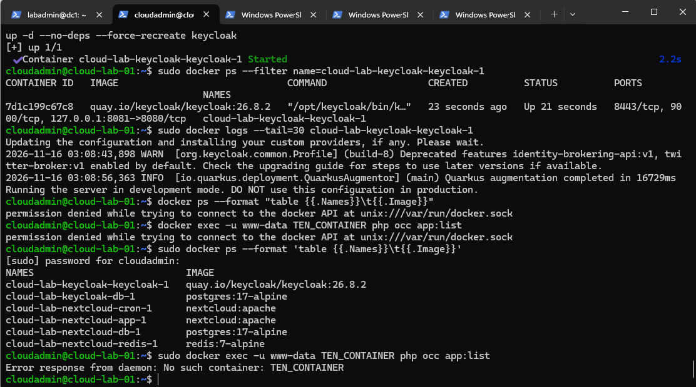
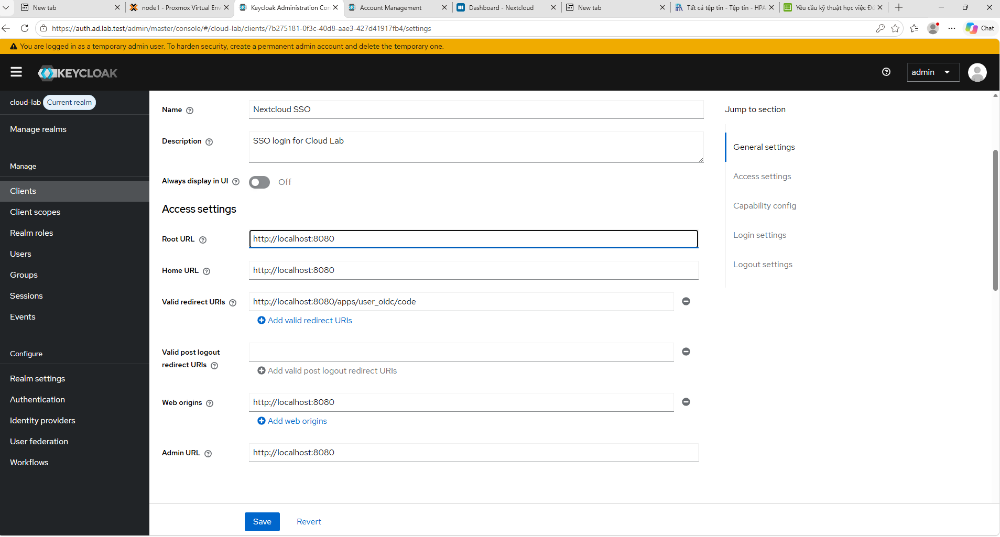
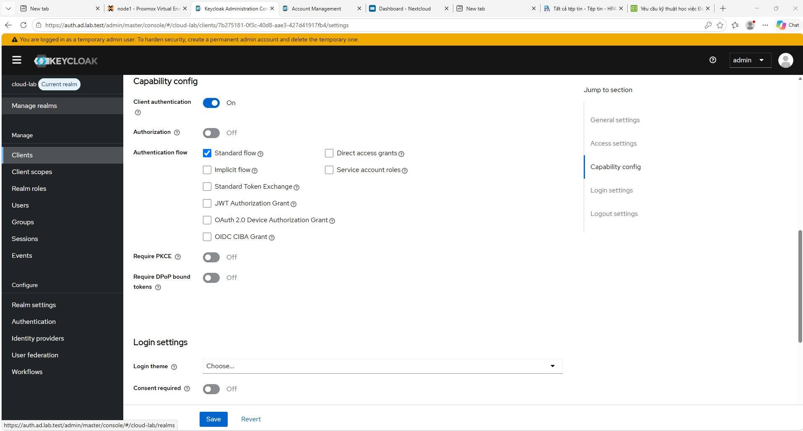
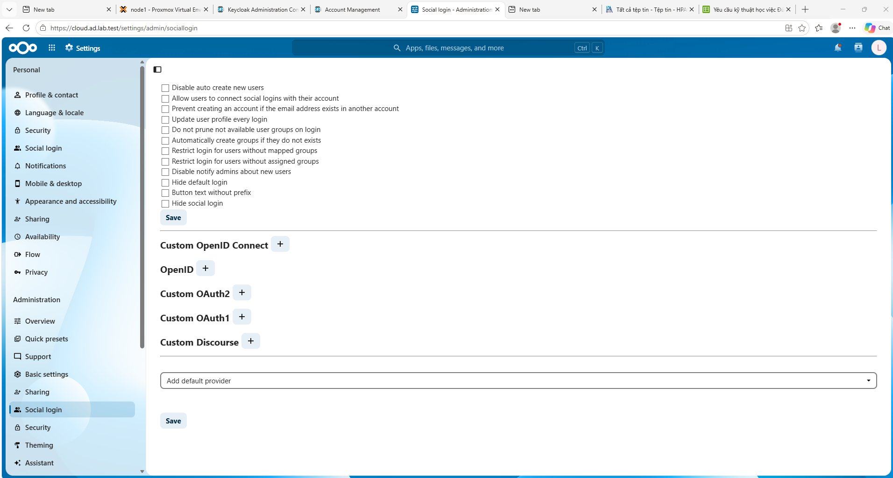
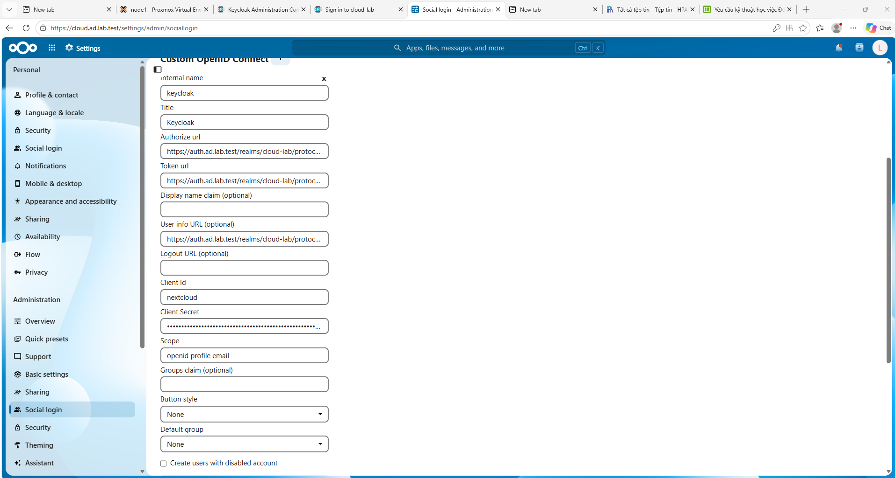
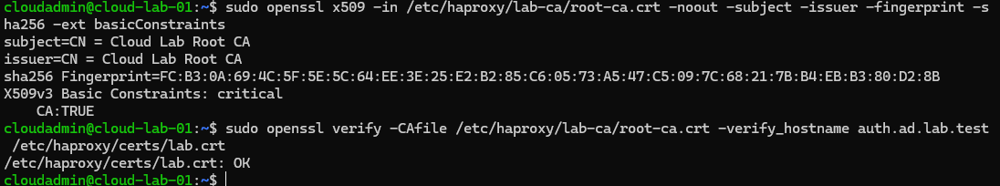
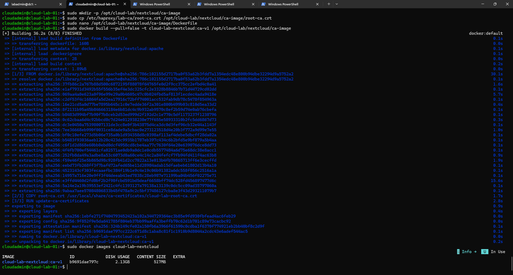
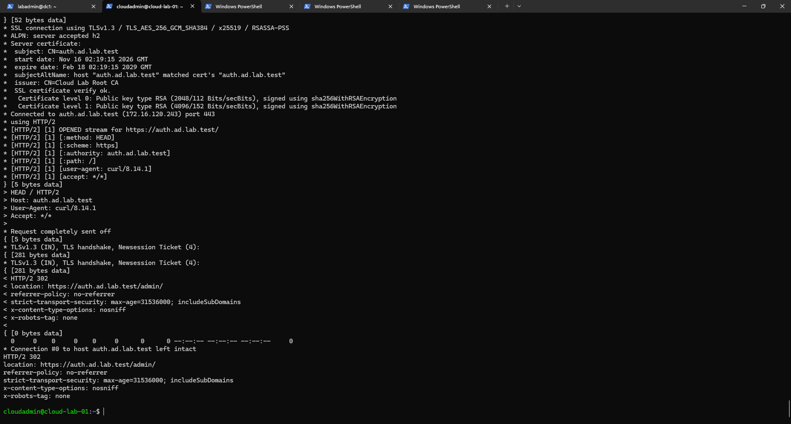
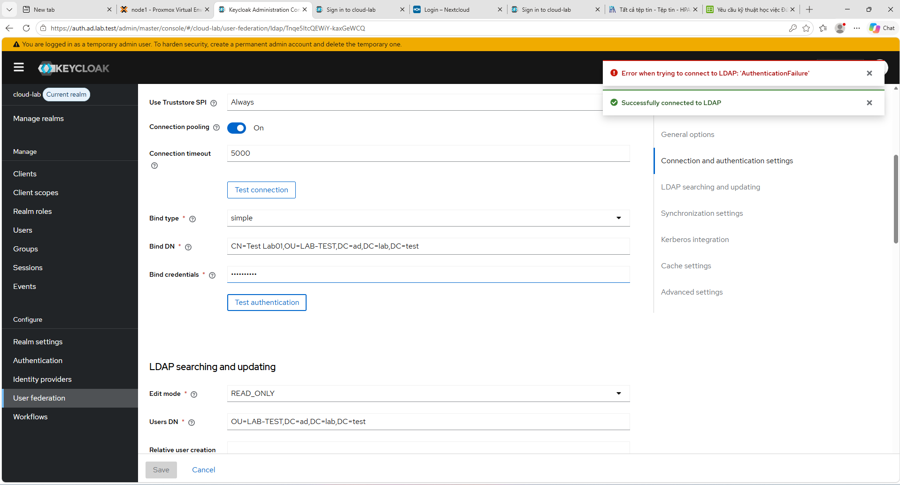

# 02 — Private Cloud LAB: Nextcloud + Keycloak + Docker + HAProxy

Tài liệu mô tả những bước đã thực hiện trong LAB, từ triển khai container đến đăng nhập Nextcloud bằng Samba AD qua Keycloak, và xử lý các lỗi thực tế.

## 1. Các dịch vụ

| Thành phần | Giá trị đã ghi nhận |
|---|---|
| VM cloud | `cloud-lab-01`, IP `172.16.120.243` |
| Keycloak | `quay.io/keycloak/keycloak:26.8.2` |
| Realm | `cloud-lab` |
| Nextcloud | `35.0.2.2` sau tạo lại container |
| Redis/Postgres | `redis:7-alpine`, `postgres:17-alpine` |
| Nextcloud Compose | `/opt/cloud-lab/nextcloud/compose.yaml` |
| Keycloak Compose | `/opt/cloud-lab/keycloak/compose.yaml` |
| URL Cloud | `https://cloud.ad.lab.test` |
| URL Auth | `https://auth.ad.lab.test` |

## 2. Kiểm tra Docker và các dịch vụ

Trên `cloudadmin@cloud-lab-01` cần `sudo` vì tài khoản thường không có quyền đọc Docker socket:

```bash
sudo docker ps --format 'table {{.Names}}\t{{.Image}}'
sudo docker compose -f /opt/cloud-lab/nextcloud/compose.yaml ps
sudo docker exec -u www-data cloud-lab-nextcloud-app-1 php occ status
```

**Đừng** thay các lệnh có chuỗi mẫu `TEN_CONTAINER`: tên container ghi nhận là `cloud-lab-nextcloud-app-1`.



*Nhận diện container Nextcloud trong Docker*


## 3. HAProxy, HTTPS và DNS nội bộ

HAProxy lắng nghe `172.16.120.243:443` và sử dụng `/etc/haproxy/certs/lab.pem`. Nextcloud được chuyển về `127.0.0.1:8080`, Keycloak sử dụng cổng nội bộ `8081`.

```bash
sudo ss -lntp | grep ':443'
sudo grep -nE 'bind|crt|host_auth|host_cloud|nextcloud_backend' /etc/haproxy/haproxy.cfg
```

Chứng chỉ `auth.ad.lab.test` do **Cloud Lab Root CA** cấp. Các đường dẫn đã xác minh:

- Root CA: `/etc/haproxy/lab-ca/root-ca.crt`
- Server certificate: `/etc/haproxy/certs/lab.crt`
- PEM dùng bởi HAProxy: `/etc/haproxy/certs/lab.pem` (có thể chứa private key, không chia sẻ)

```bash
sudo openssl verify -CAfile /etc/haproxy/lab-ca/root-ca.crt \
  -verify_hostname auth.ad.lab.test /etc/haproxy/certs/lab.crt
```

Kết quả quan sát: `/etc/haproxy/certs/lab.crt: OK`.

## 4. Keycloak Client `nextcloud`

Mở **Realm `cloud-lab` → Clients → `nextcloud` → Settings**. Không tạo client trùng; đã gặp lỗi `Client nextcloud already exists`.

| Trường / capability | Giá trị |
|---|---|
| Root URL | `https://cloud.ad.lab.test` |
| Home URL | `https://cloud.ad.lab.test` |
| Valid redirect URIs | `https://cloud.ad.lab.test/apps/sociallogin/custom_oidc/keycloak` |
| Post logout redirect | `https://cloud.ad.lab.test/` |
| Web origins | `https://cloud.ad.lab.test` |
| Client authentication | ON |
| Standard flow | ON |
| Authorization | OFF |
| Direct access grants | OFF |

Nếu dùng thêm app Nextcloud `user_oidc`, callback khác là `/apps/user_oidc/code`; không nhầm hai loại callback.

**Credentials**: sao chép Client Secret từ tab Keycloak; không đưa vào GitHub.



*Client cũ còn localhost:8080, cần sửa về DNS/HTTPS LAB*



*Capability config bật Standard Flow và Client authentication*


## 5. Cài Social Login cho Nextcloud

Bản LAB chưa có Social Login nên `/settings/admin/sociallogin` trả `Access forbidden`. Kiểm tra bằng:

```bash
sudo docker exec -u www-data cloud-lab-nextcloud-app-1 php occ app:list | grep -i -C 3 sociallogin
```

Cài và kiểm tra (đã ghi nhận phiên bản `sociallogin 6.6.3`):

```bash
sudo docker exec -u www-data cloud-lab-nextcloud-app-1 php occ app:install sociallogin
sudo docker exec -u www-data cloud-lab-nextcloud-app-1 php occ app:list --enabled | grep -i sociallogin
```

Truy cập `https://cloud.ad.lab.test/settings/admin/sociallogin`, chọn **Custom OpenID Connect** (không chọn OpenID chuẩn), nhấn dấu `+`.

| Trường | Giá trị |
|---|---|
| Internal name | `keycloak` |
| Title | `Keycloak` |
| Authorize URL | `https://auth.ad.lab.test/realms/cloud-lab/protocol/openid-connect/auth` |
| Token URL | `https://auth.ad.lab.test/realms/cloud-lab/protocol/openid-connect/token` |
| User info URL | `https://auth.ad.lab.test/realms/cloud-lab/protocol/openid-connect/userinfo` |
| Client ID | `nextcloud` |
| Client Secret | Dán nội bộ từ Keycloak, không ghi vào docs |
| Scope | `openid profile email` |
| Logout URL / Groups claim | Để trống lúc test |
| Hide default login | Không tích khi thử nghiệm |



*Trang Social Login sau khi cài ứng dụng*



*Biểu mẫu Custom OpenID Connect đã nhập Client Secret và Scope*


## 6. CA nội bộ: sửa lỗi và làm bền vững

Lỗi thực tế sau khi nhập OIDC:

```text
Unable to exchange code for API access token.
SSL certificate problem: unable to get local issuer certificate
```

Container Nextcloud không tin cậy CA của Keycloak. Đã kiểm tra root CA, import tạm vào container rồi tạo image riêng:

```dockerfile
FROM nextcloud:apache
COPY root-ca.crt /usr/local/share/ca-certificates/cloud-lab-root-ca.crt
RUN update-ca-certificates
```

**Thực hiện trong LAB:**

```bash
sudo mkdir -p /opt/cloud-lab/nextcloud/ca-image
sudo cp /etc/haproxy/lab-ca/root-ca.crt /opt/cloud-lab/nextcloud/ca-image/root-ca.crt
sudo docker build --pull=false -t cloud-lab-nextcloud:ca-v1 /opt/cloud-lab/nextcloud/ca-image
```

Trong `/opt/cloud-lab/nextcloud/compose.yaml` đổi **chỉ** image của `app` và `cron` thành `cloud-lab-nextcloud:ca-v1`, giữ nguyên các volume. Kiểm tra:

```bash
sudo docker compose -f /opt/cloud-lab/nextcloud/compose.yaml config --quiet
sudo docker compose -f /opt/cloud-lab/nextcloud/compose.yaml config --images
sudo docker inspect --format '{{.Name}}{{range .Mounts}}{{printf "\n  %s: %s -> %s" .Type .Source .Destination}}{{end}}{{println}}' cloud-lab-nextcloud-app-1 cloud-lab-nextcloud-cron-1 cloud-lab-nextcloud-db-1
```

Sau kiểm tra volume, môi trường LAB đã thực thi:

```bash
sudo docker compose -f /opt/cloud-lab/nextcloud/compose.yaml up -d --no-deps --force-recreate app cron
```

Lưu ý lệnh này gây gián đoạn ngắn, không chạy vô điều kiện khi chưa backup. Đã kiểm tra `curl ... /status.php` trả `200 OK` và `maintenance: false`, sau đó `SSL certificate verify ok` từ **container mới**.



*Đối chiếu Root CA / certificate verify: OK*



*Build image cloud-lab-nextcloud:ca-v1 có tích hợp CA*



*TLS vẫn xác thực được sau khi recreate*


## 7. Reverse proxy và chống brute force

Nextcloud trước đó hiển thị `Too many requests`, cảnh báo **Forwarded for headers**. HAProxy có cấu hình `http-request set-header X-Forwarded-For %[src]`; Docker Gateway phía container là `172.18.0.1`.

```bash
sudo docker exec -u www-data cloud-lab-nextcloud-app-1 php occ config:system:set trusted_proxies 0 --value='172.18.0.1'
sudo docker exec -u www-data cloud-lab-nextcloud-app-1 php occ config:system:set forwarded_for_headers 0 --value='HTTP_X_FORWARDED_FOR'
sudo docker exec -u www-data cloud-lab-nextcloud-app-1 php occ security:bruteforce:attempts 172.18.0.1
```

Ảnh ghi nhận `attempts: 11`, `delay: 25000 ms`; sau khi kiểm tra IP và gỡ giới hạn đúng địa chỉ:

```bash
sudo docker exec -u www-data cloud-lab-nextcloud-app-1 php occ security:bruteforce:reset 172.18.0.1
```

Kết quả `attempts: 0`, `delay: 0 ms`. **Không tắt** brute-force protection; IP proxy tin cậy cần được xác minh qua log Apache/HAProxy, tránh trust sai gateway hoặc toàn dải mạng.

## 8. LDAP bind — lỗi sau khi đổi mật khẩu AD

Keycloak LDAP Federation dùng Bind DN `CN=Test Lab01,OU=LAB-TEST,DC=ad,DC=lab,DC=test`. Khi thay mật khẩu `test.lab01` trên Samba, Keycloak vẫn dùng Bind credentials cũ, gây:

```text
LDAP: error code 49 - AcceptSecurityContext error, data 52e
```

Vào **Keycloak → Realm `cloud-lab` → User federation → LDAP cũ → Bind credentials**: nhập mật khẩu hiện hành của *chính Bind DN*, Save, rồi **Test authentication**. `Test connection` thành công chỉ chứng minh kết nối, chưa chứng minh bind thành công. Không tạo thêm provider mới ở Realm `master`.



*Test connection xanh nhưng Test authentication đỏ trong LDAP provider*


## 9. Checklist kết quả cuối

- [x] Docker image custom chứa Cloud Lab Root CA.
- [x] HAProxy / `cloud.ad.lab.test` trả trạng thái Nextcloud `200 OK` sau recreate.
- [x] `curl` từ container mới báo `SSL certificate verify ok`.
- [x] Nextcloud Social Login cài được và đã cấu hình.
- [ ] Chạy lại **Test authentication** LDAP sau khi cập nhật Bind credentials (ảnh cuối chưa xác nhận kết quả này).
- [ ] Xác thực lại luồng `test.lab01` → Keycloak → Nextcloud sau lần sửa Bind credentials cuối.
- [ ] Tạo tài khoản service LDAP riêng và quản trị Keycloak không dùng admin tạm.

Xem [troubleshooting](../docs/TROUBLESHOOTING.md) và [toàn bộ ảnh Private Cloud](SCREENSHOTS.md).
