# HƯỚNG DẪN TRIỂN KHAI SAMBA ACTIVE DIRECTORY (dc1 / ad.lab.test)

> Môi trường LAB: Proxmox VE, VM **2001 – Samba-AD-Lab** (`dc1`, IP `172.16.120.242`), Ubuntu Server 24.04.
> Samba AD chạy trong **network namespace riêng** `samba-lab`, IP `10.250.10.2`, tách khỏi mạng chính của VM.

| Thông số | Giá trị |
|---|---|
| Domain / Realm | `ad.lab.test` / `AD.LAB.TEST` |
| NetBIOS | `LAB` |
| DC | `dc1.ad.lab.test` – `10.250.10.2` |
| Namespace | `samba-lab` (veth-host `10.250.10.1/30` ↔ veth-samba `10.250.10.2/30`) |
| File cấu hình | `/opt/samba-ad-lab/host-provision/etc/smb.conf` |
| OU / Group / User thử nghiệm | `OU=LAB-TEST` / `GG-LAB-Users` / `test.lab01` |

---

## 1. Cài Ubuntu Server cho VM dc1

- Tạo VM trên Proxmox, cài Ubuntu Server 24.04, chia ổ theo LVM.
- Tại bước **SSH configuration**: tích **Install OpenSSH server**.

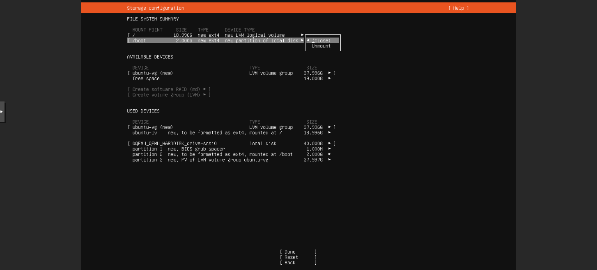
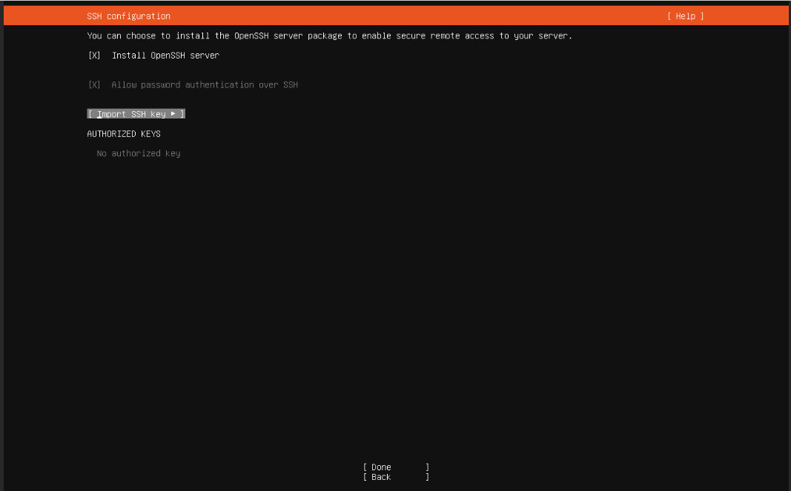

- Sau khi cài, kiểm tra IP và mạng:
```bash
ip -br addr
ip route
ping -c 4 1.1.1.1
```
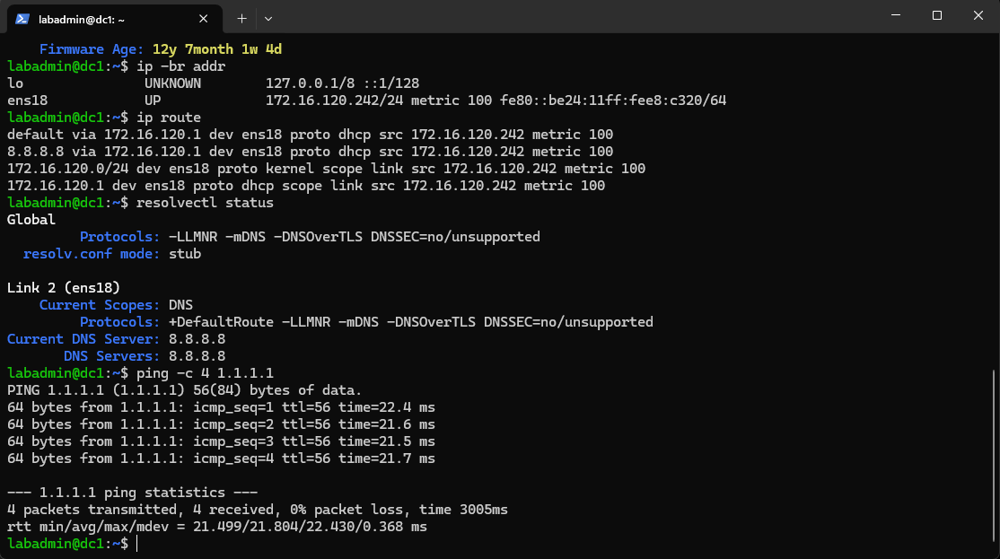

## 2. Cài gói Samba AD và Kerberos

```bash
sudo apt update
sudo apt install -y samba-ad-dc samba-ad-provision krb5-user smbclient winbind dnsmasq
samba --version
```
- Khi được hỏi **Default Kerberos version 5 realm** nhập `AD.LAB.TEST`.
- Tắt các service Samba mặc định (sẽ chạy Samba trong namespace riêng):
```bash
sudo systemctl disable --now smbd nmbd winbind samba-ad-dc
systemctl is-active smbd nmbd winbind samba-ad-dc   # phải ra inactive
```
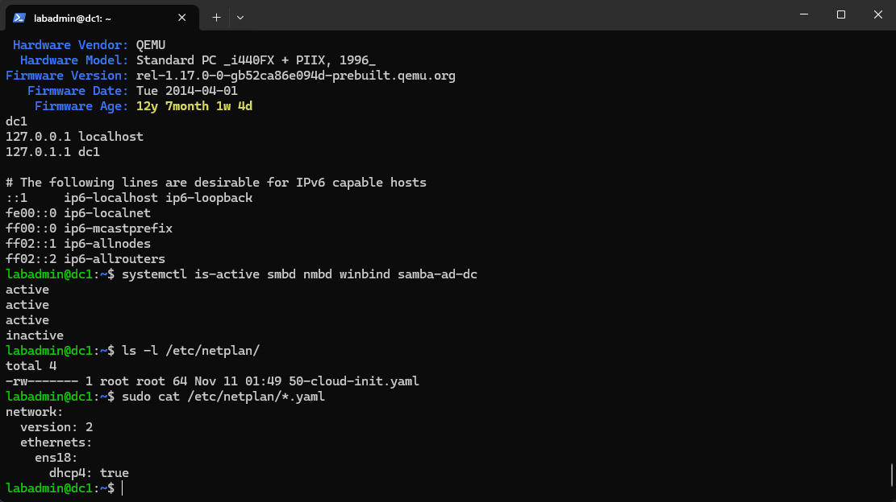

## 3. Tạo network namespace `samba-lab`

```bash
sudo ip netns add samba-lab
sudo ip link add veth-host type veth peer name veth-samba
sudo ip link set veth-samba netns samba-lab
sudo ip addr add 10.250.10.1/30 dev veth-host
sudo ip link set veth-host up
sudo ip netns exec samba-lab ip addr add 10.250.10.2/30 dev veth-samba
sudo ip netns exec samba-lab ip link set veth-samba up
sudo ip netns exec samba-lab ip link set lo up

# Kiểm tra
sudo ip netns exec samba-lab ip -br addr
sudo ip netns exec samba-lab ping -c 4 10.250.10.1
sudo sysctl net.ipv4.ip_forward     # phải = 1
```
- Hostname và resolv.conf riêng cho namespace:
```bash
sudo mkdir -p /etc/netns/samba-lab
sudo tee /etc/netns/samba-lab/hosts > /dev/null <<'EOF'
127.0.0.1 localhost
10.250.10.2 dc1.ad.lab.test dc1
::1 localhost ip6-localhost ip6-loopback
EOF
sudo tee /etc/netns/samba-lab/resolv.conf > /dev/null <<'EOF'
search ad.lab.test
nameserver 10.250.10.2
options timeout:2 attempts:1
EOF
sudo ip netns exec samba-lab getent hosts dc1.ad.lab.test   # -> 10.250.10.2
```
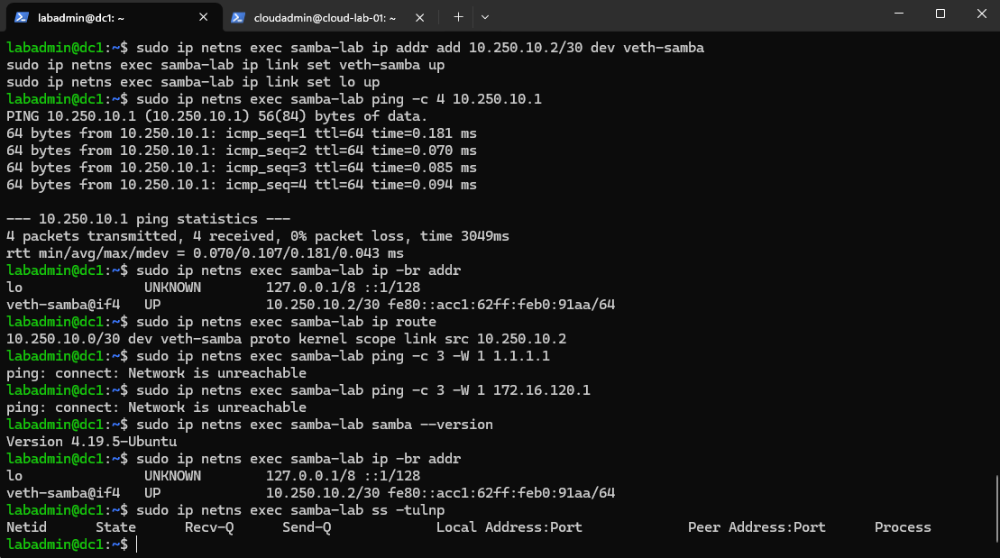
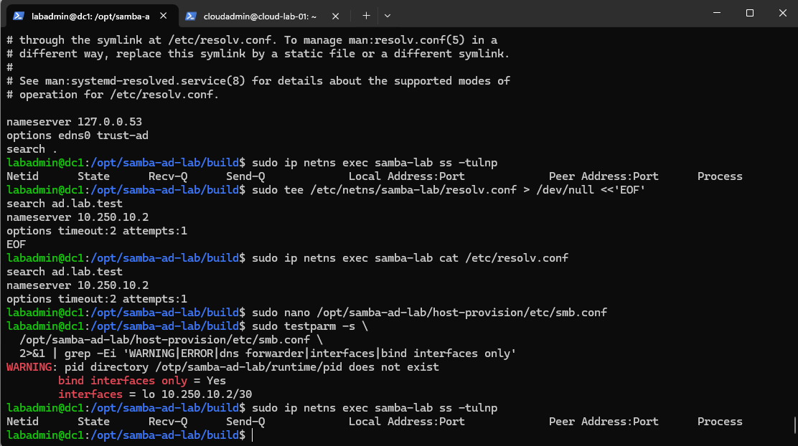

> ⚠️ Namespace, veth và route **mất khi reboot**. Đưa các lệnh trên vào một systemd unit/script khởi động nếu muốn bền vững.

## 4. Provision domain

```bash
sudo mkdir -p /opt/samba-ad-lab/{host-provision,runtime/{pid,ncalrpc,logs,lock,cache},logs}
sudo ip netns exec samba-lab env LANG=C.UTF-8 LC_ALL=C.UTF-8 \
  samba-tool domain provision \
  --realm=AD.LAB.TEST \
  --domain=LAB \
  --server-role=dc \
  --dns-backend=SAMBA_INTERNAL \
  --use-rfc2307 \
  --targetdir=/opt/samba-ad-lab/host-provision \
  > /opt/samba-ad-lab/logs/provision-host.log 2>&1
echo "PROVISION_EXIT=$?"     # phải = 0
```
- Mật khẩu Administrator được sinh ngẫu nhiên → đặt lại ở bước 7.

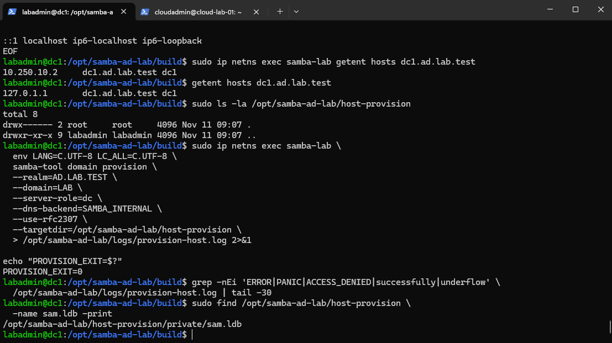
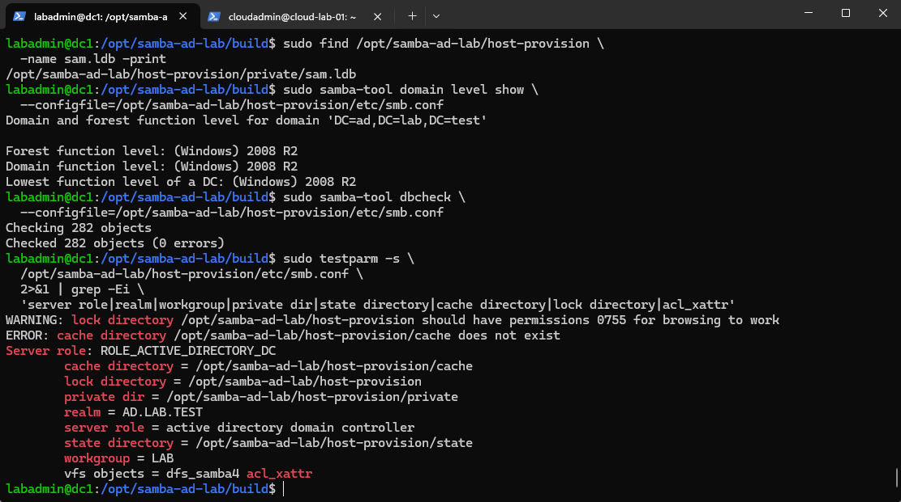

## 5. Chỉnh smb.conf cho namespace

Mở `/opt/samba-ad-lab/host-provision/etc/smb.conf`, phần `[global]` cần có (giữ nguyên các dòng provision tạo ra):
```ini
[global]
    bind interfaces only = yes
    interfaces = lo 10.250.10.2/30
    dns forwarder = 10.250.10.1
    pid directory = /run/samba-lab/pid
    ncalrpc dir = /opt/samba-ad-lab/runtime/ncalrpc
    lock directory = /opt/samba-ad-lab/runtime/lock
    cache directory = /opt/samba-ad-lab/runtime/cache
    log file = /opt/samba-ad-lab/runtime/logs/log.%m
    winbindd socket directory = /run/samba-lab/winbindd
```
```bash
sudo mkdir -p /run/samba-lab/pid /run/samba-lab/winbindd
sudo chmod 755 /run/samba-lab/pid /run/samba-lab/winbindd
sudo testparm -s /opt/samba-ad-lab/host-provision/etc/smb.conf 2>&1 | grep -Ei 'WARNING|ERROR|server role|pid directory|winbindd socket'
```
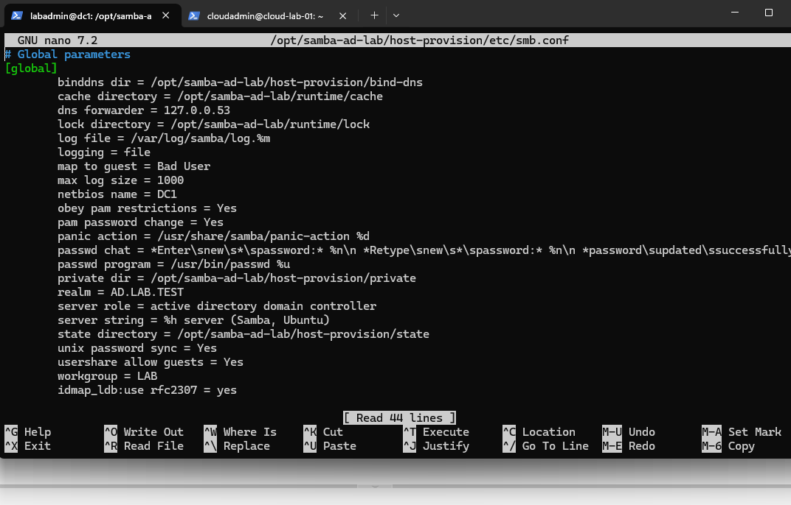
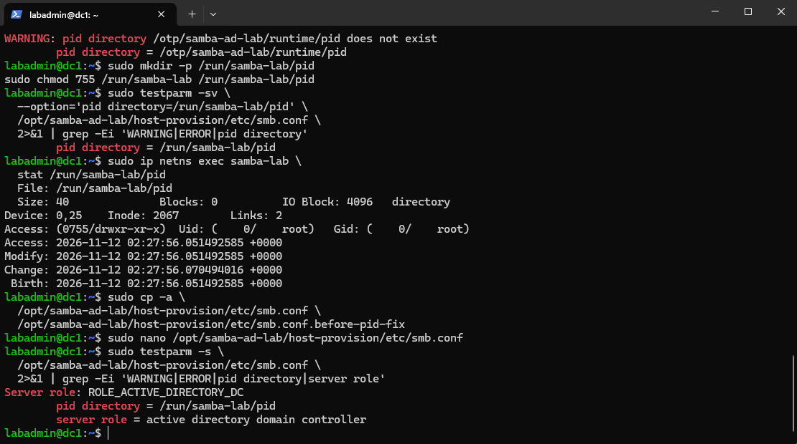
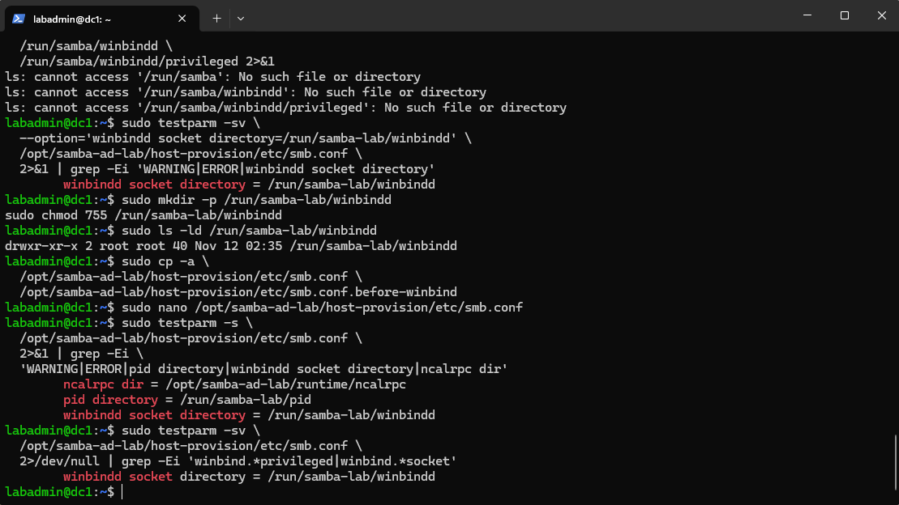

> Lỗi hay gặp: gõ nhầm `/otp/...` thay vì `/opt/...` → `mkdir failed on directory /otp/samba-ad-lab/runtime/pid`.

## 6. DNS forwarder (dnsmasq trên host)

Samba DNS chuyển các tên ngoài domain cho `10.250.10.1` (dnsmasq trên host):
```bash
sudo tee /etc/dnsmasq-samba-lab.conf > /dev/null <<'EOF'
port=53
listen-address=10.250.10.1
bind-interfaces
no-resolv
server=8.8.8.8
domain-needed
bogus-priv
EOF
sudo dnsmasq --test --conf-file=/etc/dnsmasq-samba-lab.conf
sudo dnsmasq --conf-file=/etc/dnsmasq-samba-lab.conf --pid-file=/run/dnsmasq-samba-lab.pid
```
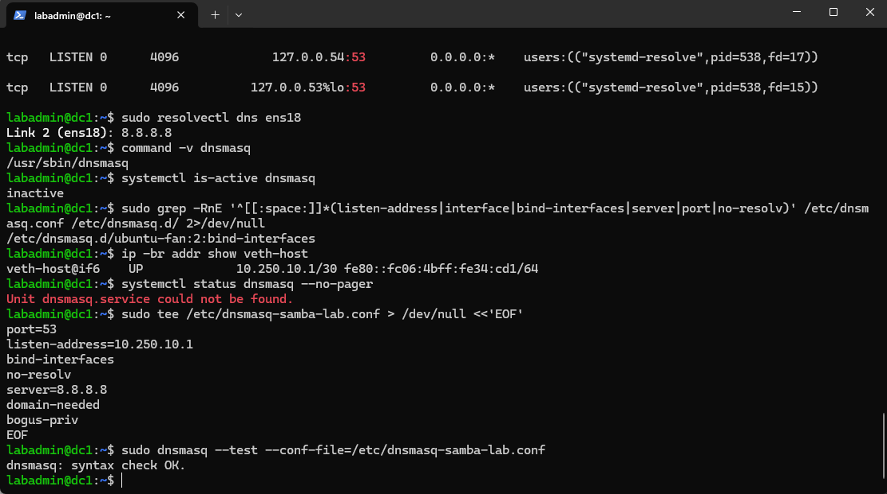

## 7. Khởi động Samba và kiểm tra

```bash
sudo ip netns exec samba-lab samba --daemon \
  --configfile=/opt/samba-ad-lab/host-provision/etc/smb.conf
sudo ip netns exec samba-lab pgrep -a samba

# DNS
sudo ip netns exec samba-lab host -t SRV _ldap._tcp.ad.lab.test 10.250.10.2
sudo ip netns exec samba-lab host www.microsoft.com 10.250.10.2
```
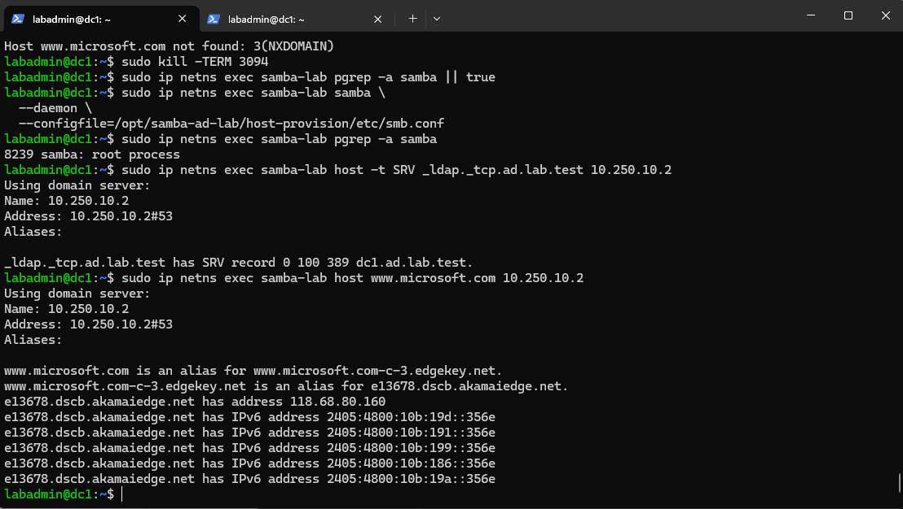

- Đặt mật khẩu Administrator và thử Kerberos:
```bash
sudo ip netns exec samba-lab samba-tool user setpassword Administrator \
  --configfile=/opt/samba-ad-lab/host-provision/etc/smb.conf
sudo ip netns exec samba-lab kinit Administrator@AD.LAB.TEST
sudo ip netns exec samba-lab klist
```
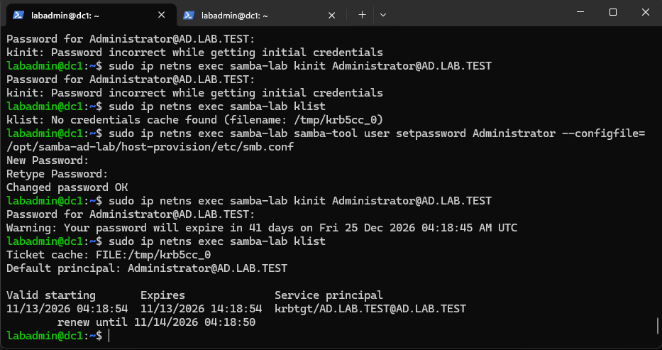

- Kiểm tra winbind và chia sẻ:
```bash
sudo ip netns exec samba-lab wbinfo -p              # Ping to winbindd succeeded
sudo ip netns exec samba-lab smbclient -L //10.250.10.2 -U 'LAB\Administrator' \
  --configfile=/opt/samba-ad-lab/host-provision/etc/smb.conf
```
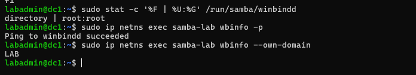
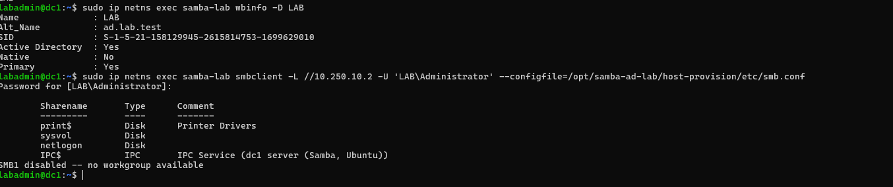

## 8. Firewall (ufw) cho phép máy khác vào AD

Chỉ mở đúng cổng, đúng máy nguồn. Ví dụ cho máy quản trị Windows `172.16.120.241`:
```bash
for r in "389 tcp LDAP" "636 tcp LDAPS" "53 tcp DNS" "53 udp DNS" "88 tcp Kerberos" "88 udp Kerberos" "445 tcp SMB" "135 tcp RPC"; do
  set -- $r
  sudo ufw route allow in on ens18 out on veth-host from 172.16.120.241 to 10.250.10.2 port $1 proto $2 comment "AD Lab $3"
done
sudo ufw allow from 172.16.120.241 to any port 22 proto tcp comment 'Windows AD Management Lab'
sudo ufw status numbered
```
- Máy **cloud-lab-01 (172.16.120.243)** chạy Keycloak cũng cần được mở **636/tcp** (LDAPS) tương tự.

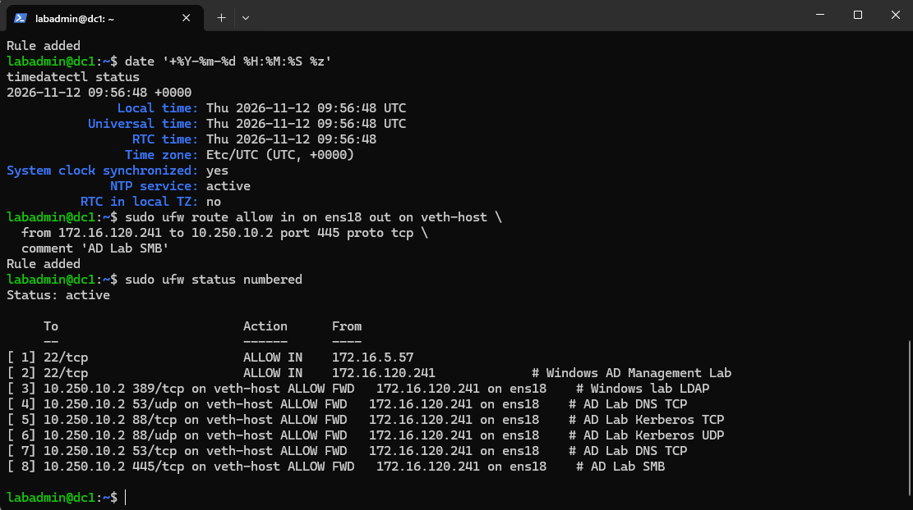
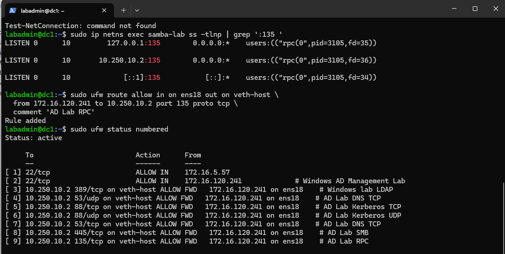

## 9. Tạo OU, Group, User thử nghiệm

Có thể dùng ADUC trên Windows ([xem 02-Windows-AD-MGMT](02-Windows-AD-MGMT.md)) hoặc lệnh:
```bash
C=--configfile=/opt/samba-ad-lab/host-provision/etc/smb.conf
sudo ip netns exec samba-lab samba-tool ou add 'OU=LAB-TEST,DC=ad,DC=lab,DC=test' $C
sudo ip netns exec samba-lab samba-tool group add GG-LAB-Users --groupou='OU=LAB-TEST' $C
sudo ip netns exec samba-lab samba-tool user create test.lab01 --userou='OU=LAB-TEST' \
  --given-name=Test --surname=Lab01 --mail-address=test.lab01@ad.lab.test $C
sudo ip netns exec samba-lab samba-tool group addmembers GG-LAB-Users test.lab01 $C
sudo ip netns exec samba-lab samba-tool group listmembers GG-LAB-Users $C
```
- Kiểm tra đăng nhập Kerberos của user:
```bash
sudo ip netns exec samba-lab kinit -c FILE:/tmp/krb5cc_test_lab01 test.lab01@AD.LAB.TEST
sudo ip netns exec samba-lab klist -c FILE:/tmp/krb5cc_test_lab01
```
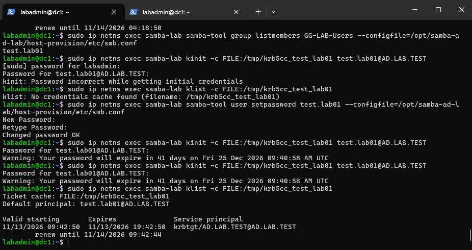

> ⚠️ Nếu tài khoản này đang được Keycloak dùng làm **Bind DN**, đổi mật khẩu xong phải cập nhật lại **Bind credentials** trong Keycloak ([05-Keycloak §3](05-Keycloak.md#3-ldap-user-federation-kết-nối-samba-ad)).

---

## Lỗi thường gặp

| Hiện tượng | Nguyên nhân | Cách xử lý |
|---|---|---|
| `sam.ldb not found` khi chạy `samba-tool` | Thiếu `--configfile` / không chạy trong namespace | Luôn dùng `ip netns exec samba-lab ... --configfile=...` |
| `mkdir failed ... /otp/...` | Gõ nhầm đường dẫn | Sửa thành `/opt/...` trong smb.conf |
| `Ping to winbindd failed` | Sai `winbindd socket directory` | Tạo `/run/samba-lab/winbindd`, khai báo trong smb.conf |
| `host www.microsoft.com` → `NXDOMAIN` | Chưa có DNS forwarder | Cấu hình dnsmasq ở mục 6, `dns forwarder = 10.250.10.1` |
| `kinit: Password incorrect` | Mật khẩu provision ngẫu nhiên | `samba-tool user setpassword` |
| Máy khác không vào được 389/636 | Thiếu rule ufw route / route tới `10.250.10.0/30` | Mục 8 và route ở máy đích (xem [05-Keycloak §2](05-Keycloak.md#2-route-tới-samba-ad)) |
