# HƯỚNG DẪN TẠO MÁY WINDOWS QUẢN TRỊ AD (WIN-SRV-AD-MGMT)

> VM **2002 – WIN-SRV-AD-MGMT**, Windows Server 2022, IP `172.16.120.241`.
> Dùng để quản trị Samba AD `ad.lab.test` bằng **Active Directory Users and Computers (ADUC)** và **DNS Manager**.

---

## 1. Tạo VM trên Proxmox

| Tab | Giá trị |
|---|---|
| General | Node `node1`, VM ID `2002`, Name `WIN-SRV-AD-MGMT` |
| OS | ISO Windows Server 2022 (`SERVER_EVAL_x64FRE`), Type **Microsoft Windows 11/2022/2025**, tích **Add additional drive for VirtIO drivers** (`virtio-win.iso`) |
| System | Machine `q35`, BIOS **OVMF (UEFI)**, EFI + TPM trên `ceph-ssd`, SCSI **VirtIO SCSI single** |
| Disks | SCSI, `ceph-ssd`, 80 GB, Discard + IO thread |
| CPU / RAM | 1 socket × 4 core / 8192 MB |
| Network | Bridge `Devqa_Vlan120`, Model VirtIO |

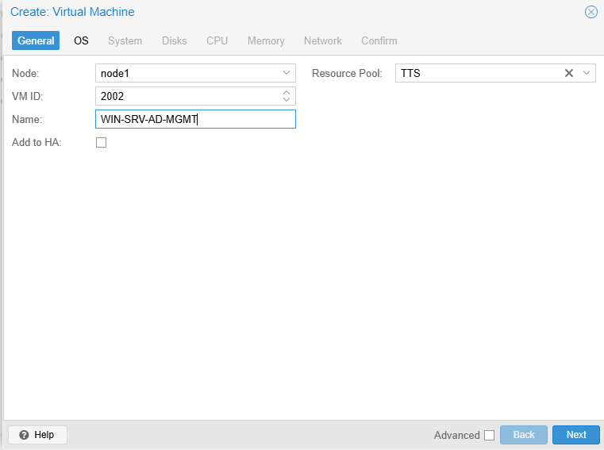
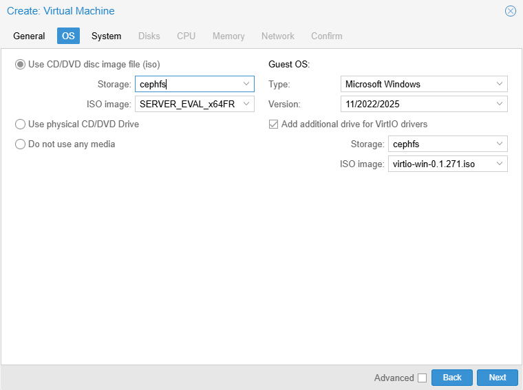
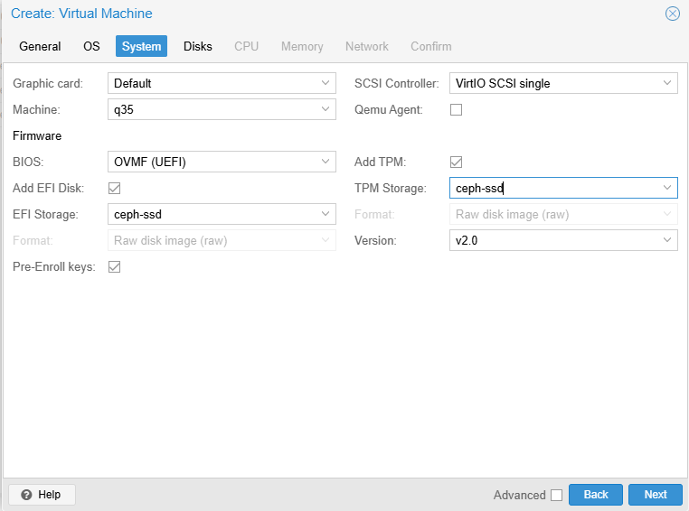
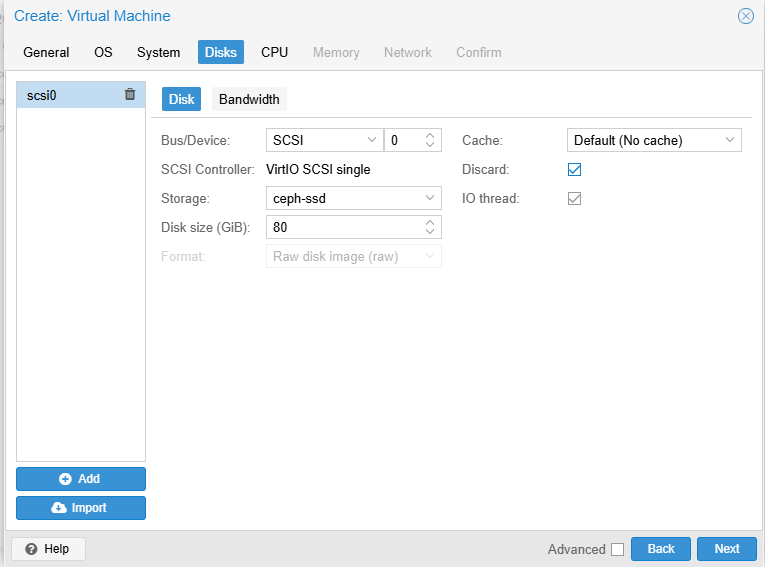
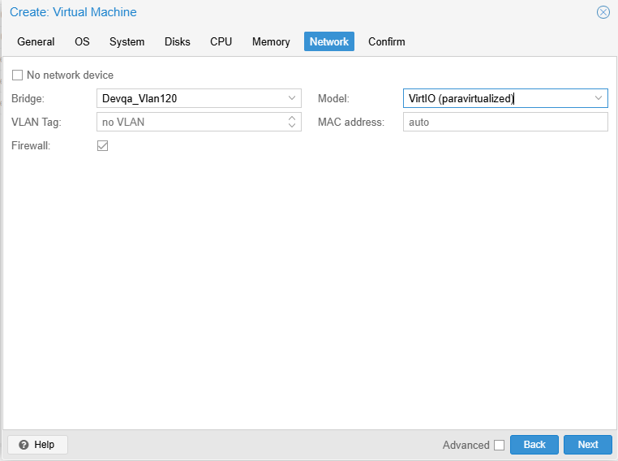
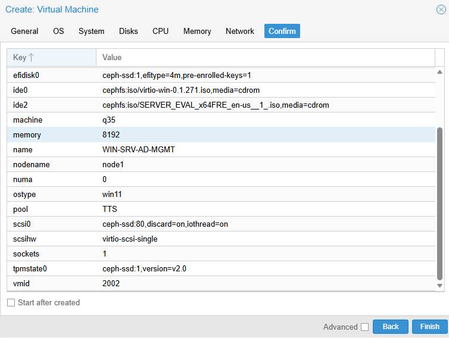

## 2. Cài Windows Server

- Boot từ ISO, chọn **Windows Server 2022 Standard Evaluation (Desktop Experience)**.
- Ở bước chọn ổ đĩa, bấm **Load driver** → trỏ vào ổ `virtio-win` → chọn driver **vioscsi\2k22\amd64** để thấy ổ cứng.

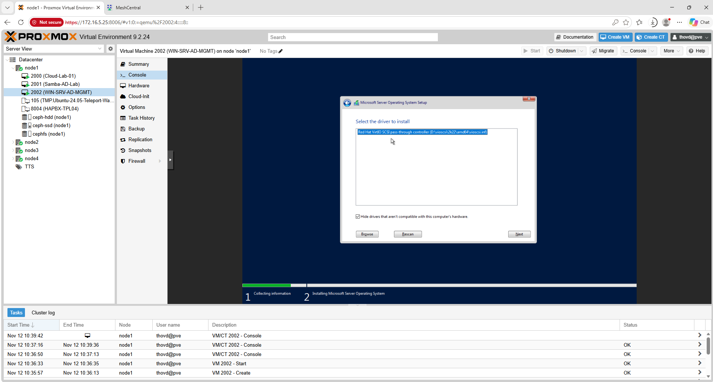

- Sau khi vào Windows: cài **virtio-win-guest-tools** (driver mạng, balloon, QEMU Guest Agent).
```powershell
Get-Service QEMU-GA        # Running
hostname
```
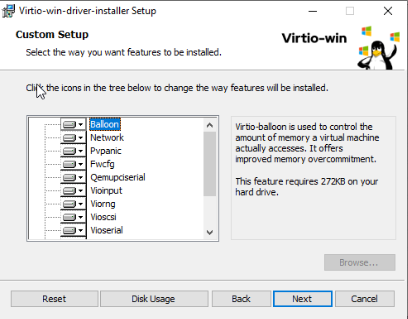

> Nếu card VirtIO không nhận, đổi Model NIC sang **Intel E1000** trong Proxmox → Hardware → Network Device.

## 3. Cài công cụ quản trị AD (RSAT)

**Server Manager → Add Roles and Features → Features → Remote Server Administration Tools → Role Administration Tools**:
- **AD DS and AD LDS Tools** (AD DS Tools, Active Directory module for PowerShell)
- **DNS Server Tools**
- **Group Policy Management**

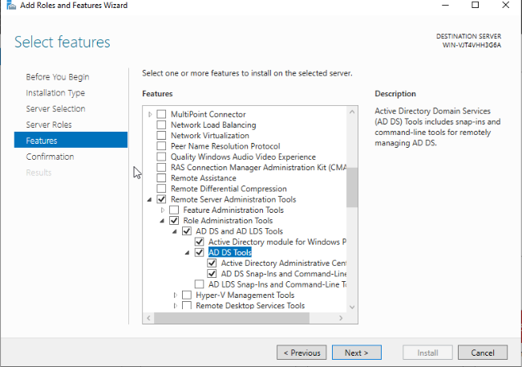
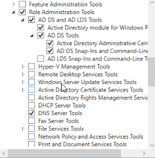

Hoặc bằng PowerShell:
```powershell
Install-WindowsFeature RSAT-AD-Tools, RSAT-DNS-Server, GPMC
Get-WindowsFeature RSAT-AD-Tools, GPMC, RSAT-DNS-Server
```
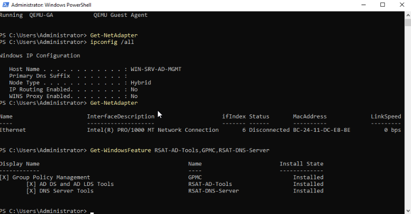

## 4. Mạng tới Samba AD

Samba nằm trong namespace `10.250.10.2` trên dc1 (`172.16.120.242`), nên Windows cần **route** và **DNS** trỏ về đó:
```powershell
# Route tới mạng Samba qua dc1
route -p add 10.250.10.0 mask 255.255.255.252 172.16.120.242

# DNS dùng Samba AD
Set-DnsClientServerAddress -InterfaceAlias "Ethernet" -ServerAddresses "10.250.10.2"
Get-DnsClientServerAddress -AddressFamily IPv4

# Kiểm tra
Test-NetConnection 10.250.10.2 -Port 389
Resolve-DnsName -Type SRV _ldap._tcp.dc._msdcs.ad.lab.test -Server 10.250.10.2
nltest /dsgetdc:ad.lab.test /force
```
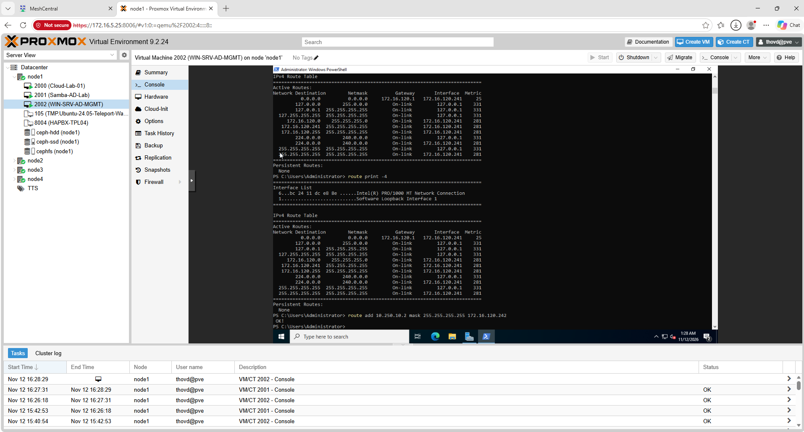
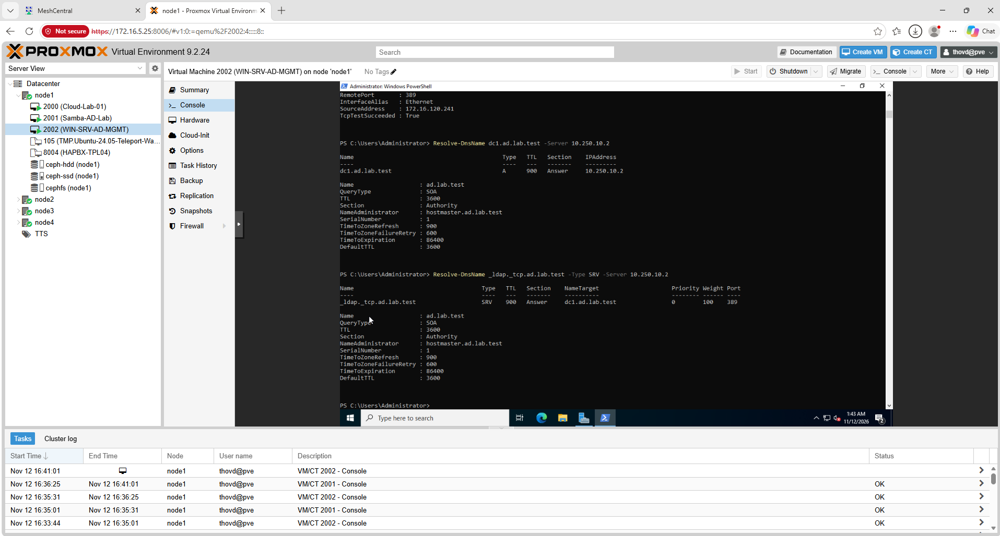
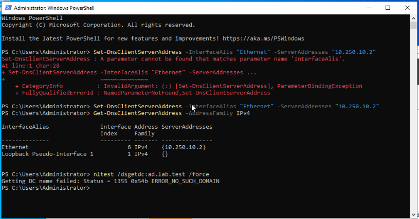
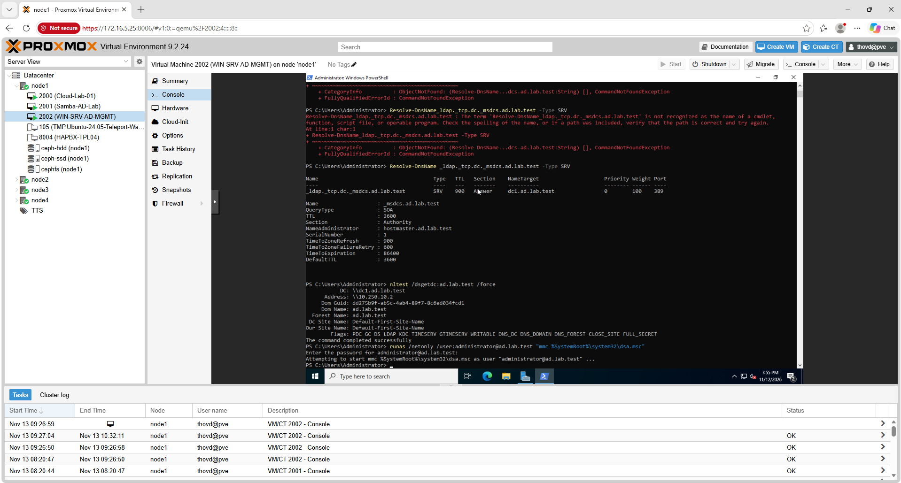

> Phía dc1 phải có rule `ufw route` cho `172.16.120.241` (xem [01-Samba-AD §8](01-Samba-AD.md#8-firewall-ufw-cho-phép-máy-khác-vào-ad)).

## 5. Quản trị bằng ADUC

- Mở **Active Directory Users and Computers** → chuột phải gốc → **Change Domain** → `ad.lab.test`.
- Đăng nhập bằng `LAB\Administrator` (dùng `runas /netonly` nếu máy Windows chưa join domain):
```powershell
runas /netonly /user:LAB\Administrator "mmc dsa.msc"
```
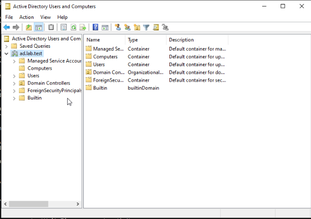
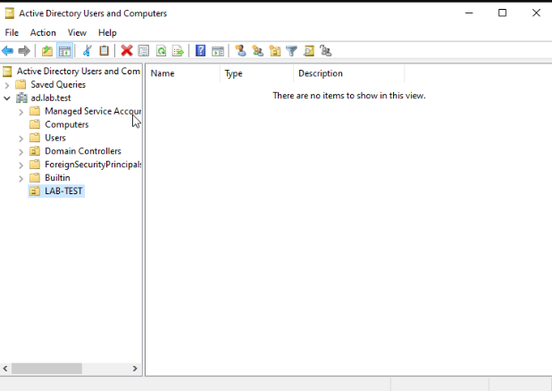

### 5.1 Tạo user mới
Chuột phải **LAB-TEST → New → User**:
- First name `Duc`, Last name `Tho`, **User logon name** `ductho` (đây là username đăng nhập SSO)
- Đặt mật khẩu, **bỏ tích** *User must change password at next logon*, tích **Password never expires**

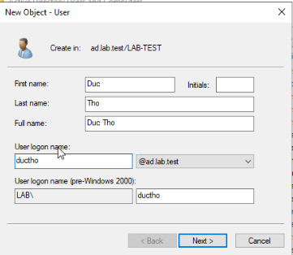

> Cảnh báo *"Windows cannot verify that the user name is unique... global catalog"* là do cổng **3268** (Global Catalog) chưa mở. User **vẫn được tạo**, bấm OK. Muốn hết cảnh báo thì mở thêm rule ufw cho port 3268.

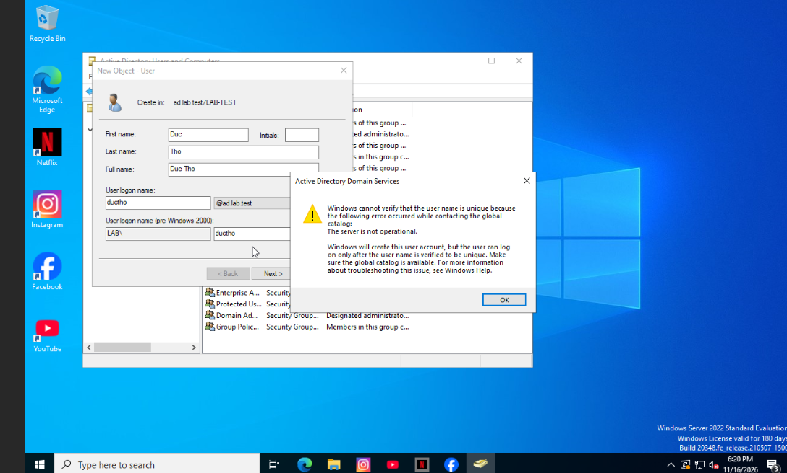

### 5.2 Thuộc tính bắt buộc cho SSO / Mail
Chuột phải user → **Properties**:
- Tab **General** → **E-mail**: `ductho@ad.lab.test` (Nextcloud và Mailcow **cần email**)
- Tab **Account** → kiểm tra logon name, *Password never expires*, **không** tích *Account is disabled*

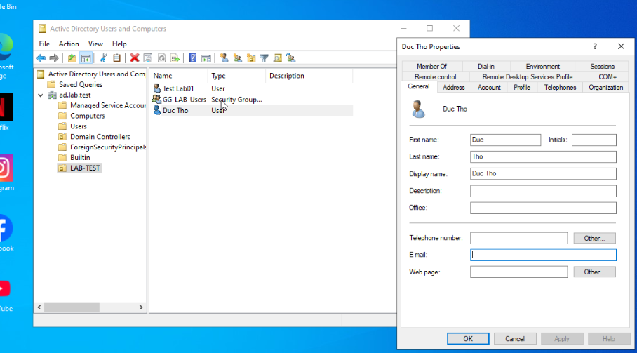
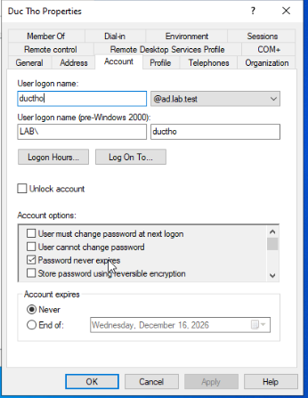

### 5.3 Thêm user vào group
Chuột phải user → **Add to a group…** → `GG-LAB-Users`.

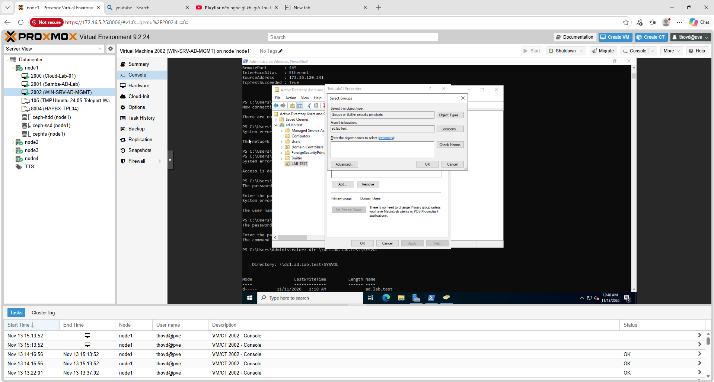

---

## Lỗi thường gặp

| Hiện tượng | Cách xử lý |
|---|---|
| `Test-NetConnection ... TcpTestSucceeded: False` | Thiếu route `10.250.10.0/30` hoặc rule ufw trên dc1 |
| `nltest ... ERROR_NO_SUCH_DOMAIN` | DNS client chưa trỏ `10.250.10.2` |
| `The specified domain either does not exist` khi mở ADUC | Kiểm tra DNS + SRV record, dùng `runas /netonly` |
| `Password change rejected... password history` | Chọn mật khẩu chưa dùng trong 24 lần gần nhất |
| Không tìm thấy `dnsmgmt.msc` | `Install-WindowsFeature RSAT-DNS-Server` |
