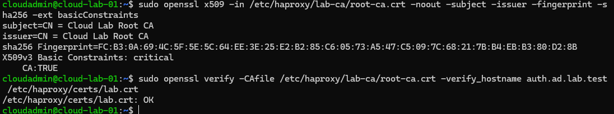
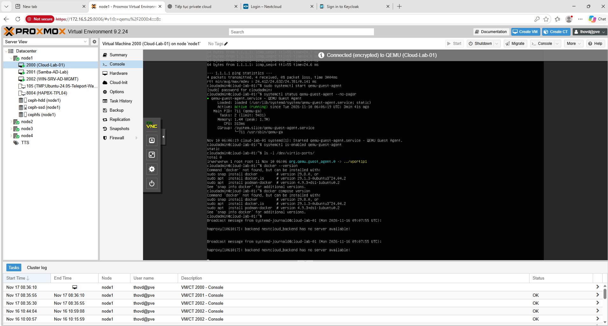

# HƯỚNG DẪN HAPROXY + HTTPS BẰNG CA NỘI BỘ (Cloud Lab Root CA)

> Máy **cloud-lab-01** (VM 2000, `172.16.120.243`, Ubuntu 24.04).
> HAProxy nhận HTTPS ở `172.16.120.243:443` và chuyển vào các dịch vụ chỉ nghe trên `127.0.0.1`:

| Domain | Backend |
|---|---|
| `auth.ad.lab.test` | Keycloak `127.0.0.1:8081` |
| `cloud.ad.lab.test` | Nextcloud `127.0.0.1:8080` |
| `mail.ad.lab.test` (+ `autodiscover`, `autoconfig`) | Mailcow `127.0.0.1:8090` |

> Domain `.test` không xin được Let's Encrypt, nên LAB dùng **CA tự quản** `Cloud Lab Root CA`. Máy nào truy cập các trang này phải **tin CA** (import `root-ca.crt`) và có tên miền trong **file hosts** hoặc DNS.

---

## 1. Cài HAProxy
```bash
sudo apt update
sudo apt install -y haproxy
haproxy -v
sudo cp /etc/haproxy/haproxy.cfg /etc/haproxy/haproxy.cfg.bak
```

## 2. Tạo CA nội bộ và chứng chỉ
```bash
sudo mkdir -p /etc/haproxy/lab-ca /etc/haproxy/certs
cd /etc/haproxy/lab-ca

# 2.1 Root CA (làm 1 lần, giữ kín root-ca.key)
sudo openssl req -x509 -newkey rsa:4096 -nodes -sha256 -days 3650 \
  -keyout root-ca.key -out root-ca.crt -subj "/CN=Cloud Lab Root CA"
sudo chmod 600 root-ca.key

# 2.2 Chứng chỉ cho auth + cloud
sudo tee /tmp/lab-ext.cnf > /dev/null <<'EOF'
basicConstraints=CA:FALSE
keyUsage=digitalSignature,keyEncipherment
extendedKeyUsage=serverAuth
subjectAltName=DNS:auth.ad.lab.test,DNS:cloud.ad.lab.test
EOF
sudo openssl req -new -newkey rsa:2048 -nodes -keyout /etc/haproxy/certs/lab.key \
  -out /tmp/lab.csr -subj "/CN=auth.ad.lab.test"
sudo openssl x509 -req -in /tmp/lab.csr -CA root-ca.crt -CAkey root-ca.key -CAcreateserial \
  -days 825 -sha256 -extfile /tmp/lab-ext.cnf -out /etc/haproxy/certs/lab.crt

# 2.3 File PEM cho HAProxy = cert + key
sudo bash -c 'cat /etc/haproxy/certs/lab.crt /etc/haproxy/certs/lab.key > /etc/haproxy/certs/lab.pem'
sudo chmod 600 /etc/haproxy/certs/lab.pem /etc/haproxy/certs/lab.key

# 2.4 Kiểm tra
sudo openssl verify -CAfile root-ca.crt -verify_hostname auth.ad.lab.test /etc/haproxy/certs/lab.crt
openssl x509 -in /etc/haproxy/certs/lab.crt -noout -subject -issuer -enddate -ext subjectAltName
```


> Chứng chỉ cho `mail.ad.lab.test` được cấp riêng (`mail.pem`) ở [06-MailCow §4](06-MailCow.md#4-cấp-chứng-chỉ-cho-mailadlabtest).

## 3. Cấu hình `/etc/haproxy/haproxy.cfg`
```haproxy
global
    log /dev/log local0
    log /dev/log local1 notice
    maxconn 2048
    user haproxy
    group haproxy

defaults
    log global
    mode http
    option httplog
    timeout connect 5s
    timeout client 60s
    timeout server 60s

frontend lab_https
    bind 172.16.120.243:443 ssl crt /etc/haproxy/certs/lab.pem crt /etc/haproxy/certs/mail.pem

    acl host_auth  hdr(host) -i auth.ad.lab.test
    acl host_cloud hdr(host) -i cloud.ad.lab.test
    acl host_mail  hdr(host) -i mail.ad.lab.test autodiscover.ad.lab.test autoconfig.ad.lab.test

    http-request deny unless host_auth or host_cloud or host_mail

    http-request del-header Forwarded
    http-request set-header X-Forwarded-Proto https
    http-request set-header X-Forwarded-Port 443
    http-request set-header X-Forwarded-Host %[req.hdr(Host)]
    http-request set-header X-Forwarded-For %[src]

    use_backend keycloak_backend  if host_auth
    use_backend nextcloud_backend if host_cloud
    use_backend mailcow_backend   if host_mail

backend keycloak_backend
    server keycloak 127.0.0.1:8081 check

backend nextcloud_backend
    server nextcloud 127.0.0.1:8080 check

backend mailcow_backend
    server mailcow 127.0.0.1:8090 check
```
> Khi chưa cài Mailcow: bỏ `crt .../mail.pem`, dòng `acl host_mail`, `or host_mail`, `use_backend mailcow_backend` và backend `mailcow_backend`.

## 4. Kiểm tra và áp dụng
```bash
sudo haproxy -c -f /etc/haproxy/haproxy.cfg     # Configuration file is valid
sudo systemctl reload haproxy
sudo ss -lntp | grep ':443'

curl -s -o /dev/null -w '%{http_code}\n' --cacert /etc/haproxy/lab-ca/root-ca.crt https://auth.ad.lab.test/realms/cloud-lab
curl -s -o /dev/null -w '%{http_code}\n' --cacert /etc/haproxy/lab-ca/root-ca.crt https://cloud.ad.lab.test/login
```
Kết quả mong đợi: `200`.

## 5. Phía máy người dùng (Windows)

1. **File hosts** – mở Notepad bằng **Run as administrator** (hoặc PowerShell Admin), thêm vào `C:\Windows\System32\drivers\etc\hosts`:
   ```
   172.16.120.243 auth.ad.lab.test cloud.ad.lab.test mail.ad.lab.test
   ```
   PowerShell (Admin) thêm `mail` vào dòng đã có:
   ```powershell
   (Get-Content C:\Windows\System32\drivers\etc\hosts) -replace '^(\s*172\.16\.120\.243 auth\.ad\.lab\.test cloud\.ad\.lab\.test)\s*$', '$1 mail.ad.lab.test' | Set-Content C:\Windows\System32\drivers\etc\hosts -Encoding ASCII
   ```
   > Nếu Notepad hiện hộp **Save as** khi bấm Ctrl+S → Notepad **chưa** chạy quyền Admin.
2. **Tin CA** – copy `root-ca.crt` về máy, nhấp đúp → **Install Certificate** → *Local Machine* → *Trusted Root Certification Authorities*.

---

## Lỗi thường gặp

| Hiện tượng | Nguyên nhân / Cách xử lý |
|---|---|
| `backend nextcloud_backend has no server available!` | Container Nextcloud chưa chạy hoặc không nghe `127.0.0.1:8080` → `sudo docker ps`, xem log container |
| Trình duyệt báo *NET::ERR_CERT_AUTHORITY_INVALID* | Máy chưa import `root-ca.crt` |
| `403 Forbidden` | Domain không nằm trong `http-request deny unless ...` |
| Keycloak lặp chuyển hướng / sai `https` | Thiếu header `X-Forwarded-*` hoặc Keycloak chưa đặt `KC_PROXY_HEADERS=xforwarded` |


