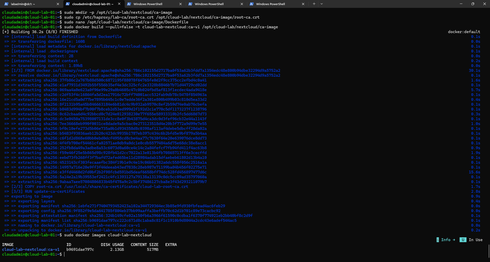
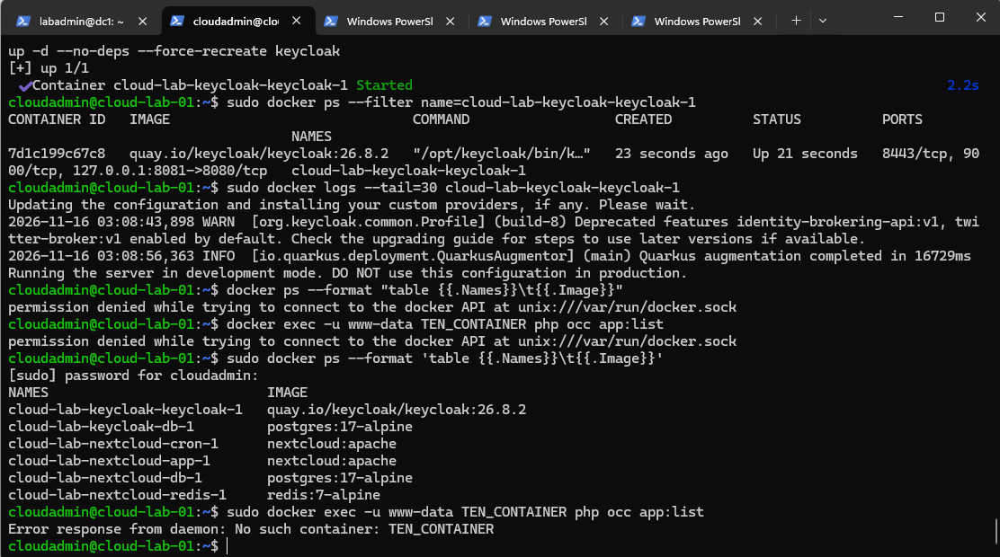
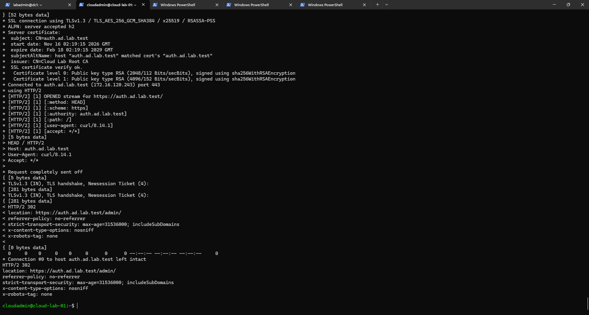

# HƯỚNG DẪN CÀI ĐẶT NEXTCLOUD BẰNG DOCKER COMPOSE

> Máy **cloud-lab-01** (VM 2000, `172.16.120.243`), thư mục `/opt/cloud-lab/nextcloud`.
> Nextcloud chỉ nghe `127.0.0.1:8080`, đi ra ngoài qua HAProxy: `https://cloud.ad.lab.test` ([03-HAProxy](03-HAProxy.md)).

---

## 1. Cài Docker Engine + Compose plugin
```bash
sudo apt update
sudo apt install -y ca-certificates curl gnupg
sudo install -m 0755 -d /etc/apt/keyrings
curl -fsSL https://download.docker.com/linux/ubuntu/gpg | sudo gpg --dearmor -o /etc/apt/keyrings/docker.gpg
echo "deb [arch=$(dpkg --print-architecture) signed-by=/etc/apt/keyrings/docker.gpg] https://download.docker.com/linux/ubuntu $(lsb_release -cs) stable" \
  | sudo tee /etc/apt/sources.list.d/docker.list > /dev/null
sudo apt update
sudo apt install -y docker-ce docker-ce-cli containerd.io docker-compose-plugin
sudo systemctl enable --now docker
docker --version && docker compose version
```
> Trong LAB, `cloudadmin` **không** thuộc nhóm `docker` nên mọi lệnh docker đều chạy với `sudo`.

## 2. Tạo thư mục và file bí mật
```bash
sudo mkdir -p /opt/cloud-lab/nextcloud && cd /opt/cloud-lab/nextcloud
sudo tee .env > /dev/null <<'EOF'
POSTGRES_PASSWORD=<đặt_mật_khẩu_db>
NEXTCLOUD_ADMIN_PASSWORD=<đặt_mật_khẩu_admin>
EOF
sudo chmod 600 .env
```
> ⚠️ **Không commit `.env` lên GitHub.**

## 3. Image Nextcloud có tin Cloud Lab Root CA
Nextcloud phải gọi `https://auth.ad.lab.test` (Keycloak) và `mail.ad.lab.test` (IMAP/SMTP). Nếu container không tin CA nội bộ sẽ báo `SSL certificate problem: unable to get local issuer certificate`. Tạo image riêng:
```bash
sudo mkdir -p /opt/cloud-lab/nextcloud/ca-image
sudo cp /etc/haproxy/lab-ca/root-ca.crt /opt/cloud-lab/nextcloud/ca-image/root-ca.crt
sudo tee /opt/cloud-lab/nextcloud/ca-image/Dockerfile > /dev/null <<'EOF'
FROM nextcloud:apache
COPY root-ca.crt /usr/local/share/ca-certificates/cloud-lab-root-ca.crt
RUN update-ca-certificates
EOF
sudo docker build -t cloud-lab-nextcloud:ca-v1 /opt/cloud-lab/nextcloud/ca-image
```


## 4. File `compose.yaml`
```yaml
name: cloud-lab-nextcloud

services:
  db:
    image: postgres:17-alpine
    restart: unless-stopped
    environment:
      POSTGRES_DB: nextcloud
      POSTGRES_USER: nextcloud
      POSTGRES_PASSWORD: ${POSTGRES_PASSWORD}
    volumes:
      - db_data:/var/lib/postgresql/data
    networks:
      - backend

  redis:
    image: redis:7-alpine
    restart: unless-stopped
    networks:
      - backend

  app:
    image: cloud-lab-nextcloud:ca-v1
    restart: unless-stopped
    ports:
      - "127.0.0.1:8080:80"
    environment:
      POSTGRES_HOST: db
      POSTGRES_DB: nextcloud
      POSTGRES_USER: nextcloud
      POSTGRES_PASSWORD: ${POSTGRES_PASSWORD}
      REDIS_HOST: redis
      NEXTCLOUD_ADMIN_USER: labadmin
      NEXTCLOUD_ADMIN_PASSWORD: ${NEXTCLOUD_ADMIN_PASSWORD}
      NEXTCLOUD_TRUSTED_DOMAINS: "localhost 127.0.0.1"
    volumes:
      - nextcloud_data:/var/www/html
    depends_on:
      - db
      - redis
    networks:
      - backend

  cron:
    image: cloud-lab-nextcloud:ca-v1
    restart: unless-stopped
    entrypoint: /cron.sh
    volumes:
      - nextcloud_data:/var/www/html
    depends_on:
      - app
    networks:
      - backend

volumes:
  db_data:
  nextcloud_data:

networks:
  backend:
```

## 5. Khởi động
```bash
cd /opt/cloud-lab/nextcloud
sudo docker compose config --quiet && sudo docker compose up -d
sudo docker compose ps
sudo docker exec -u www-data cloud-lab-nextcloud-app-1 php occ status
```


## 6. Cấu hình chạy sau HAProxy HTTPS
```bash
OCC="sudo docker exec -u www-data cloud-lab-nextcloud-app-1 php occ"
$OCC config:system:set trusted_domains 1 --value=cloud.ad.lab.test
$OCC config:system:set overwrite.cli.url --value=https://cloud.ad.lab.test
$OCC config:system:set overwriteprotocol --value=https
$OCC config:system:set overwritehost --value=cloud.ad.lab.test

# HAProxy -> Docker gateway: tin proxy và đọc IP thật từ X-Forwarded-For
$OCC config:system:set trusted_proxies 0 --value='172.18.0.1'
$OCC config:system:set forwarded_for_headers 0 --value='HTTP_X_FORWARDED_FOR'
```
> `172.18.0.1` là gateway của network Docker `backend` trong LAB. Kiểm tra lại bằng `sudo docker network inspect cloud-lab-nextcloud_backend`.

Kiểm tra:
```bash
curl -s --cacert /etc/haproxy/lab-ca/root-ca.crt https://cloud.ad.lab.test/status.php
```
Truy cập `https://cloud.ad.lab.test` và đăng nhập `labadmin`.

## 7. Cài app cần dùng
```bash
$OCC app:install sociallogin   # đăng nhập bằng Keycloak (05-Keycloak)
$OCC app:install mail          # đọc mail Mailcow (07-Lien-ket)
$OCC app:list | grep -iE 'sociallogin|mail'
```

---

## Lỗi thường gặp

| Hiện tượng | Cách xử lý |
|---|---|
| `Too many requests` / cảnh báo *Forwarded for headers* | Đặt `trusted_proxies`, `forwarded_for_headers` (mục 6) rồi `occ security:bruteforce:reset 172.18.0.1` |
| `SSL certificate problem: unable to get local issuer certificate` | Dùng image `cloud-lab-nextcloud:ca-v1` (mục 3), `docker compose up -d --force-recreate app cron` |
| `Access through untrusted domain` | Thiếu `trusted_domains` |
| `permission denied ... docker.sock` | Chạy docker với `sudo` |


