# HƯỚNG DẪN TRIỂN KHAI KEYCLOAK, KẾT NỐI SAMBA AD VÀ SSO NEXTCLOUD

> Máy **cloud-lab-01** (VM 2000, `172.16.120.243`), thư mục `/opt/cloud-lab/keycloak`.
> Keycloak **26.8.2**, nghe `127.0.0.1:8081`, đi ra ngoài qua HAProxy: `https://auth.ad.lab.test`.
> Realm dùng cho LAB: **`cloud-lab`**.

## Luồng đăng nhập
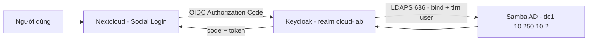

---

## 1. Docker Compose cho Keycloak
```bash
sudo mkdir -p /opt/cloud-lab/keycloak/truststore && cd /opt/cloud-lab/keycloak
sudo tee .env > /dev/null <<'EOF'
KC_DB_PASSWORD=<mật_khẩu_db>
KC_BOOTSTRAP_ADMIN_PASSWORD=<mật_khẩu_admin_tạm>
EOF
sudo chmod 600 .env
# CA của Samba AD để Keycloak tin chứng chỉ LDAPS của dc1
sudo cp samba-ad-ca.pem /opt/cloud-lab/keycloak/truststore/samba-ad-ca.pem
```
`compose.yaml`:
```yaml
name: cloud-lab-keycloak

services:
  db:
    image: postgres:17-alpine
    restart: unless-stopped
    environment:
      POSTGRES_DB: keycloak
      POSTGRES_USER: keycloak
      POSTGRES_PASSWORD: ${KC_DB_PASSWORD}
    volumes:
      - keycloak_db:/var/lib/postgresql/data
    healthcheck:
      test: ["CMD-SHELL", "pg_isready -U keycloak -d keycloak"]
      interval: 10s
      timeout: 5s
      retries: 10
    networks:
      - backend

  keycloak:
    image: quay.io/keycloak/keycloak:26.8.2
    command: start-dev
    restart: unless-stopped
    mem_limit: 2g
    extra_hosts:
      dc1.ad.lab.test: "10.250.10.2"
    ports:
      - "127.0.0.1:8081:8080"
    environment:
      KC_DB: postgres
      KC_DB_URL: jdbc:postgresql://db:5432/keycloak
      KC_DB_USERNAME: keycloak
      KC_DB_PASSWORD: ${KC_DB_PASSWORD}
      KC_BOOTSTRAP_ADMIN_USERNAME: admin
      KC_BOOTSTRAP_ADMIN_PASSWORD: ${KC_BOOTSTRAP_ADMIN_PASSWORD}
      KC_HOSTNAME: https://auth.ad.lab.test
      KC_HTTP_ENABLED: "true"
      KC_PROXY_HEADERS: xforwarded
      KC_TRUSTSTORE_PATHS: /opt/keycloak/conf/truststores/samba-ad-ca.pem
    volumes:
      - ./truststore/samba-ad-ca.pem:/opt/keycloak/conf/truststores/samba-ad-ca.pem:ro
    depends_on:
      db:
        condition: service_healthy
    networks:
      - backend

volumes:
  keycloak_db:

networks:
  backend:
    driver: bridge
```
> - Từ Keycloak 25+, **không** dùng `KC_HOSTNAME_URL`, `KC_PROXY` (đã bị bỏ), và dùng `KC_BOOTSTRAP_ADMIN_*` thay cho `KEYCLOAK_ADMIN*`.
> - Bản đang chạy trong LAB ghi nhầm `KC_TRUSTSORE_PATHS` (thiếu chữ T) nhưng vẫn chạy vì Keycloak tự đọc thư mục `conf/truststores`. Nên sửa lại cho đúng tên.
> - `start-dev` chỉ dùng cho LAB. Môi trường thật dùng `start` + build tối ưu.

```bash
sudo docker compose up -d
sudo docker compose ps
curl -s -o /dev/null -w '%{http_code}\n' http://127.0.0.1:8081/realms/master   # 200
```
Truy cập `https://auth.ad.lab.test/admin` bằng `admin`.

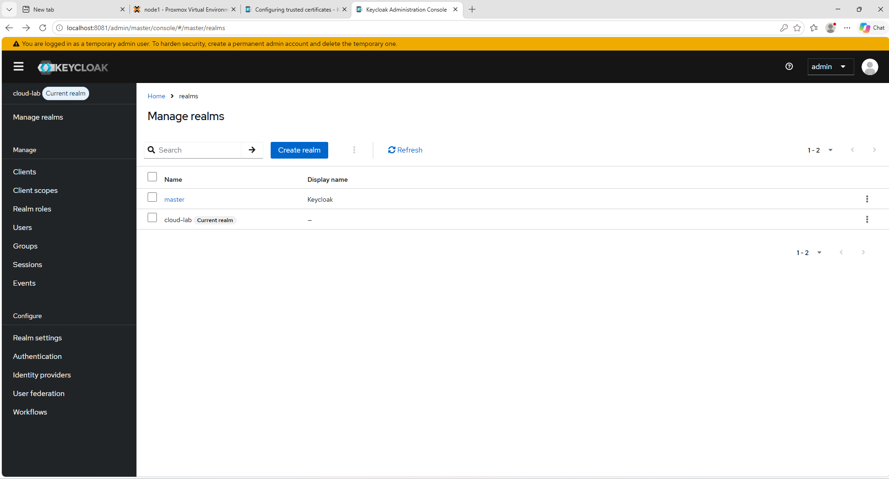

## 2. Route tới Samba AD
Samba AD nằm sau dc1 (`172.16.120.242`), nên VM 2000 cần route tới `10.250.10.2`. **Route thêm bằng `ip route` sẽ mất khi reboot** → lưu vĩnh viễn bằng systemd-networkd:
```bash
sudo ip route replace 10.250.10.2/32 via 172.16.120.242 dev ens18
sudo mkdir -p /etc/systemd/network/10-netplan-ens18.network.d
sudo tee /etc/systemd/network/10-netplan-ens18.network.d/50-ad-lab-route.conf > /dev/null <<'EOF'
# Route tới Samba AD dc1.ad.lab.test (namespace trên VM 2001)
[Route]
Destination=10.250.10.2/32
Gateway=172.16.120.242
EOF

ip route get 10.250.10.2                       # via 172.16.120.242
timeout 4 bash -c '</dev/tcp/10.250.10.2/636' && echo "LDAPS OK"
sudo docker exec cloud-lab-keycloak-keycloak-1 bash -c 'echo > /dev/tcp/10.250.10.2/636' && echo "KEYCLOAK -> LDAPS OK"
```
> Kèm theo: trên dc1 phải có rule `ufw route` cho `172.16.120.243` port `636/tcp` ([01-Samba-AD §8](01-Samba-AD.md#8-firewall-ufw-cho-phép-máy-khác-vào-ad)).

## 3. LDAP User Federation (kết nối Samba AD)

### 3.1 Tạo realm
**Manage realms → Create realm** → Realm name `cloud-lab`.

### 3.2 Thêm LDAP provider
Trong realm `cloud-lab` → **User federation → Add Ldap providers**.

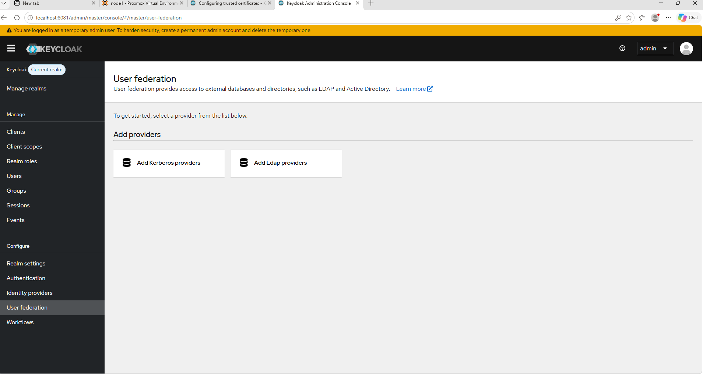
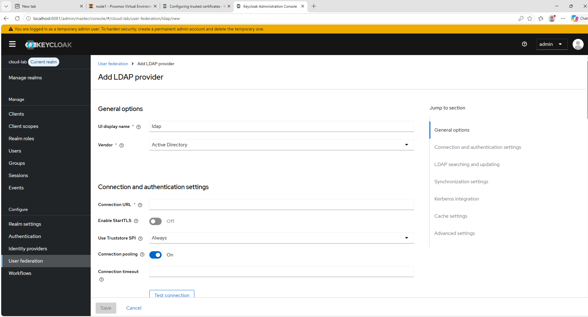

| Mục | Giá trị |
|---|---|
| UI display name | `ldap` |
| Vendor | **Active Directory** |
| Connection URL | `ldaps://dc1.ad.lab.test:636` |
| Enable StartTLS | Off |
| Use Truststore SPI | Always |
| Bind type | simple |
| Bind DN | `CN=Test Lab01,OU=LAB-TEST,DC=ad,DC=lab,DC=test` |
| Bind credentials | mật khẩu **hiện tại** của tài khoản Bind DN |
| Edit mode | `READ_ONLY` |
| Users DN | `OU=LAB-TEST,DC=ad,DC=lab,DC=test` |
| Username LDAP attribute | `sAMAccountName` |
| RDN LDAP attribute | `cn` |
| UUID LDAP attribute | `objectGUID` |
| User object classes | `person, organizationalPerson, user` |
| Search scope | One Level |
| Import users | On |

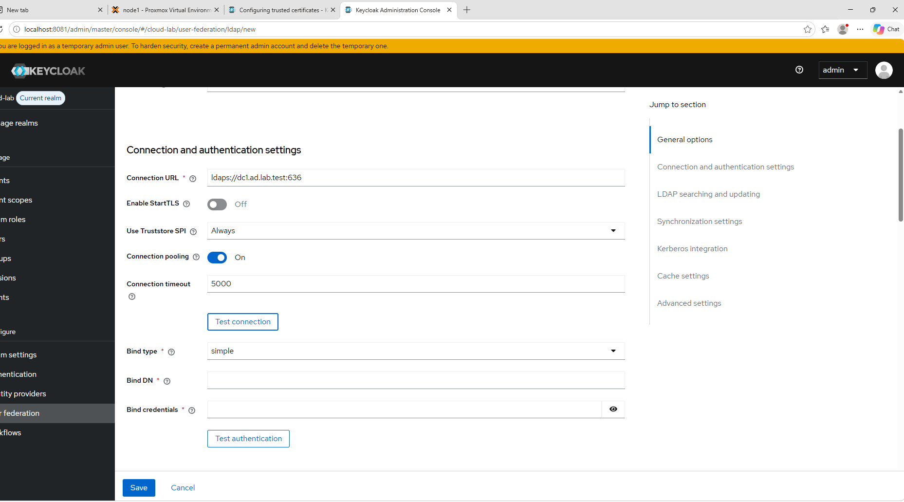
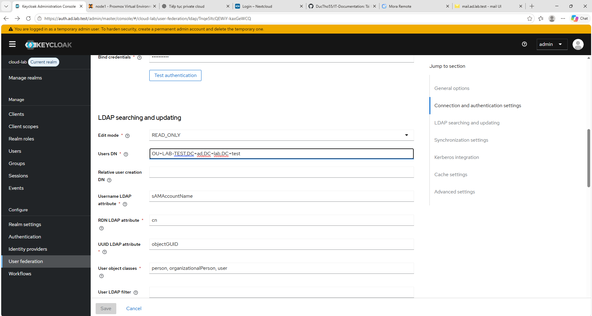

- Bấm **Test connection** → *Successfully connected to LDAP*.
- Bấm **Test authentication** → phải **xanh**. Nếu đỏ `AuthenticationFailure` → **Bind credentials sai** (xem Lỗi thường gặp).
- Bấm **Save** (Test xong mà không Save thì mật khẩu không được lưu).

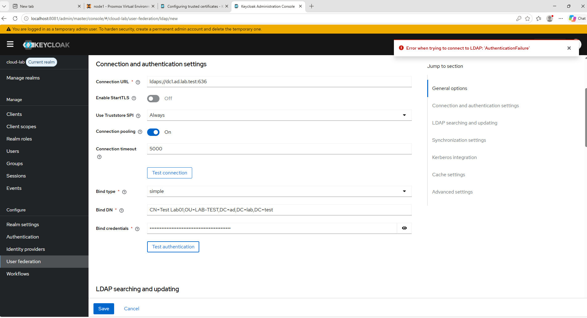

> Khuyến nghị: tạo tài khoản dịch vụ riêng (ví dụ `svc-keycloak`, chỉ đọc, *Password never expires*) để bind, thay vì dùng user thử nghiệm `Test Lab01`.

## 4. Client `nextcloud`
Realm `cloud-lab` → **Clients → Create client**:
- **General settings**: Client type `OpenID Connect`, Client ID `nextcloud`, Name `Nextcloud SSO`
- **Capability config**: **Client authentication = On**, chỉ tích **Standard flow**

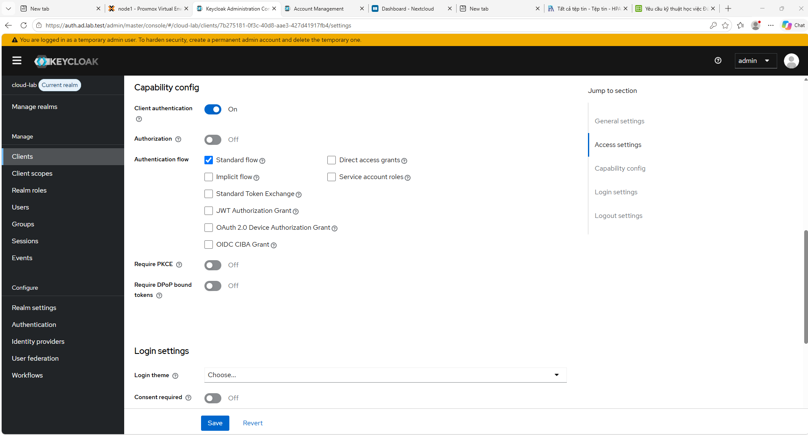

- **Login settings**:

| Mục | Giá trị |
|---|---|
| Root URL / Home URL | `https://cloud.ad.lab.test` |
| Valid redirect URIs | `https://cloud.ad.lab.test/apps/sociallogin/custom_oidc/keycloak` |
| Valid post logout redirect URIs | `https://cloud.ad.lab.test/` |
| Web origins | `https://cloud.ad.lab.test` |

- Tab **Credentials** → copy **Client Secret** (không ghi vào tài liệu/GitHub).

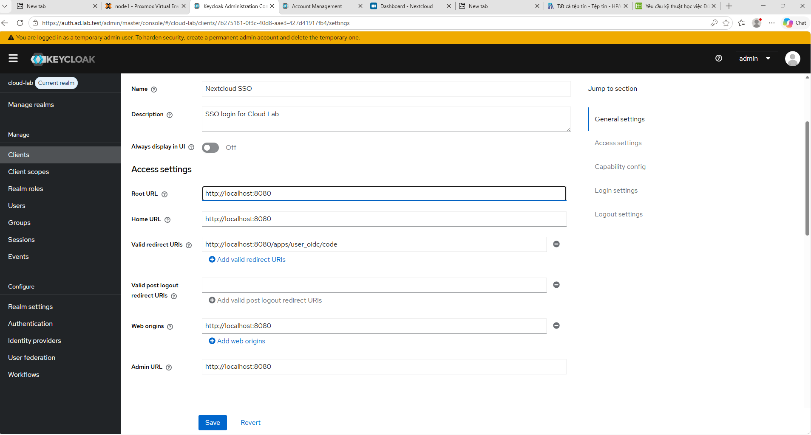

## 5. Social Login trên Nextcloud
Cài app (nếu chưa): `sudo docker exec -u www-data cloud-lab-nextcloud-app-1 php occ app:install sociallogin`

Nextcloud → **Administration settings → Social login → Custom OpenID Connect → +**:

| Trường | Giá trị |
|---|---|
| Internal name | `keycloak` |
| Title | `Keycloak` |
| Authorize URL | `https://auth.ad.lab.test/realms/cloud-lab/protocol/openid-connect/auth` |
| Token URL | `https://auth.ad.lab.test/realms/cloud-lab/protocol/openid-connect/token` |
| User info URL | `https://auth.ad.lab.test/realms/cloud-lab/protocol/openid-connect/userinfo` |
| Logout URL | `https://auth.ad.lab.test/realms/cloud-lab/protocol/openid-connect/logout` |
| Client ID | `nextcloud` |
| Client Secret | dán từ Keycloak |
| Scope | `openid profile email` |
| Display name claim | `name` |

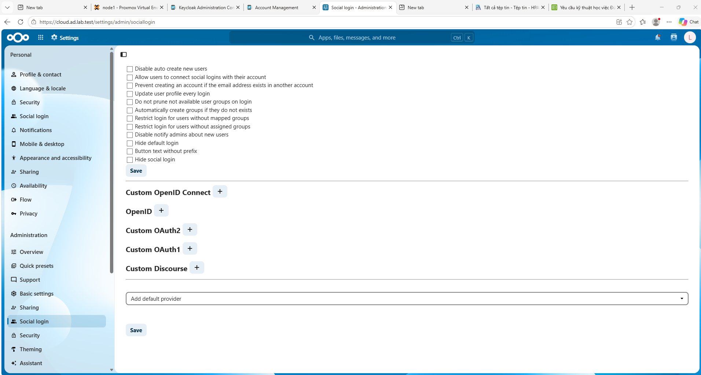
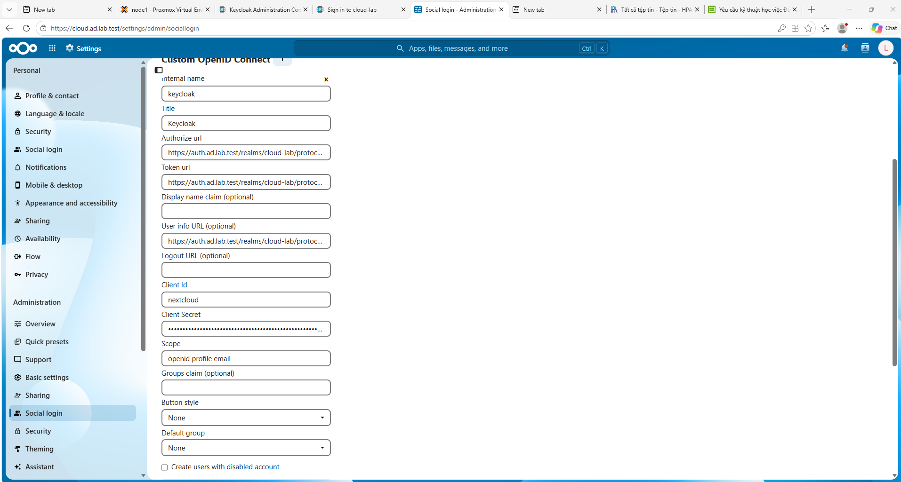

> **Internal name** `keycloak` phải khớp với đuôi Redirect URI `/custom_oidc/keycloak` ở mục 4.

## 6. Kiểm tra đăng nhập SSO
1. Mở cửa sổ **InPrivate**, vào `https://cloud.ad.lab.test/login` → bấm **Log in with Keycloak**.
2. Trang **CLOUD-LAB** của Keycloak hiện ra → đăng nhập bằng **user AD** (ví dụ `ductho` / mật khẩu AD).
3. Quay về **Nextcloud Dashboard** là thành công.

Tài khoản đăng nhập lấy ở đâu? → Là **user trong OU `LAB-TEST` của AD**, tạo bằng ADUC trên máy Windows ([02-Windows-AD-MGMT §5](02-Windows-AD-MGMT.md#5-quản-trị-bằng-aduc)).

---

## Lỗi thường gặp

| Hiện tượng | Nguyên nhân | Cách xử lý |
|---|---|---|
| Trang Keycloak *"We are sorry… Unexpected error when handling authentication request to identity provider"* | Keycloak không bind được AD (**Bind credentials sai**) | User federation → ldap → nhập lại **Bind credentials** → **Test authentication** → **Save** |
| `LDAP: error code 49 ... data 52e` | Sai mật khẩu Bind DN (thường sau khi đổi mật khẩu user đó trong AD) | Như trên |
| *Invalid username or password* với user AD, log có `Connect timed out` + `user_not_found` | **Mất route** tới `10.250.10.2` (VM 2000 reboot) | Mục 2 – lưu route vĩnh viễn |
| *Invalid username or password*, mạng bình thường | User sai OU, bị disable, hoặc bắt *must change password* | Kiểm tra user trong ADUC, Reset Password |
| `invalid_redirect_uri` | Redirect URI không khớp | Mục 4 – đúng `/apps/sociallogin/custom_oidc/keycloak` |
| Nextcloud: `Unable to exchange code... SSL certificate problem` | Nextcloud không tin CA | [04-Nextcloud §3](04-Nextcloud.md#3-image-nextcloud-có-tin-cloud-lab-root-ca) |

Xem log Keycloak:
```bash
sudo docker logs --since 10m cloud-lab-keycloak-keycloak-1 2>&1 | grep -E 'WARN|ERROR' | grep -v full-scope | tail -30
```

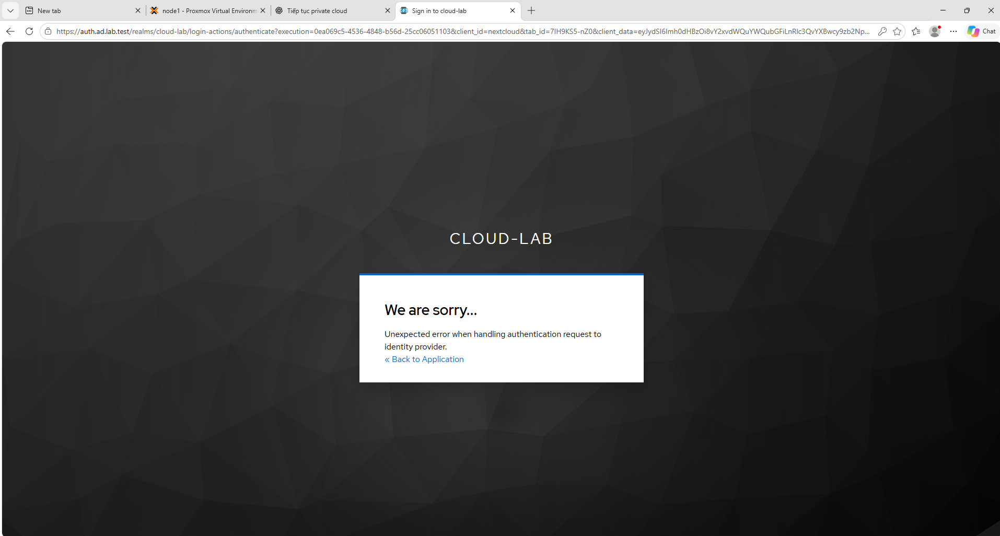
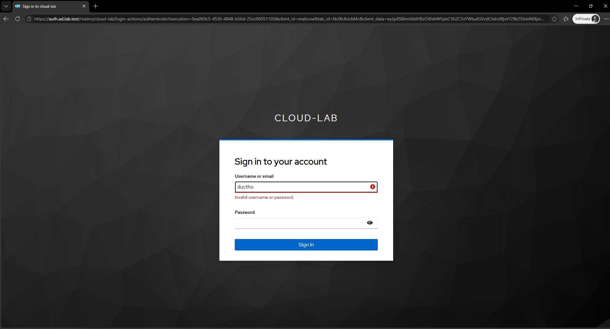
