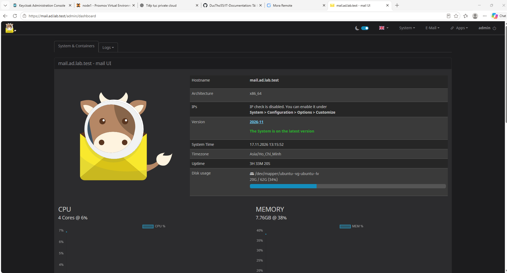
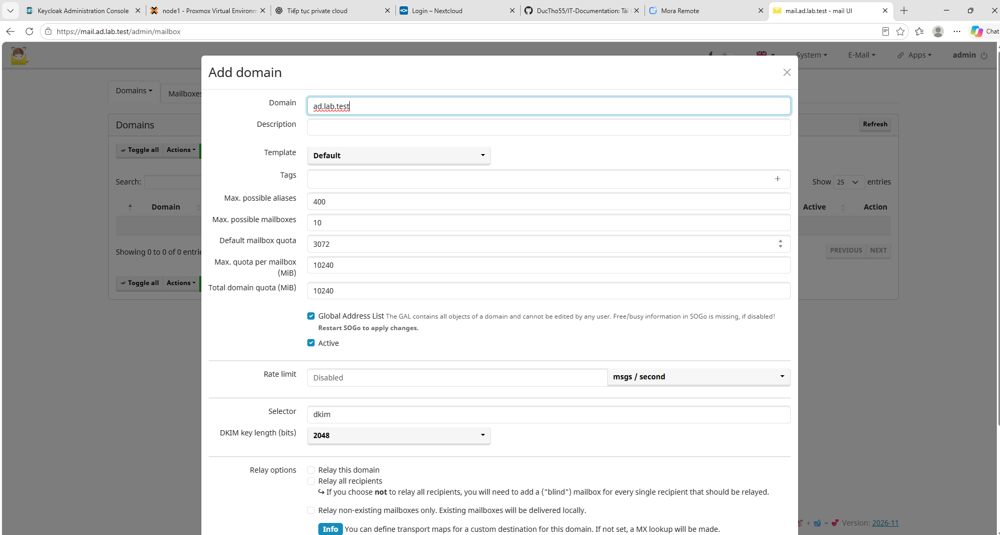
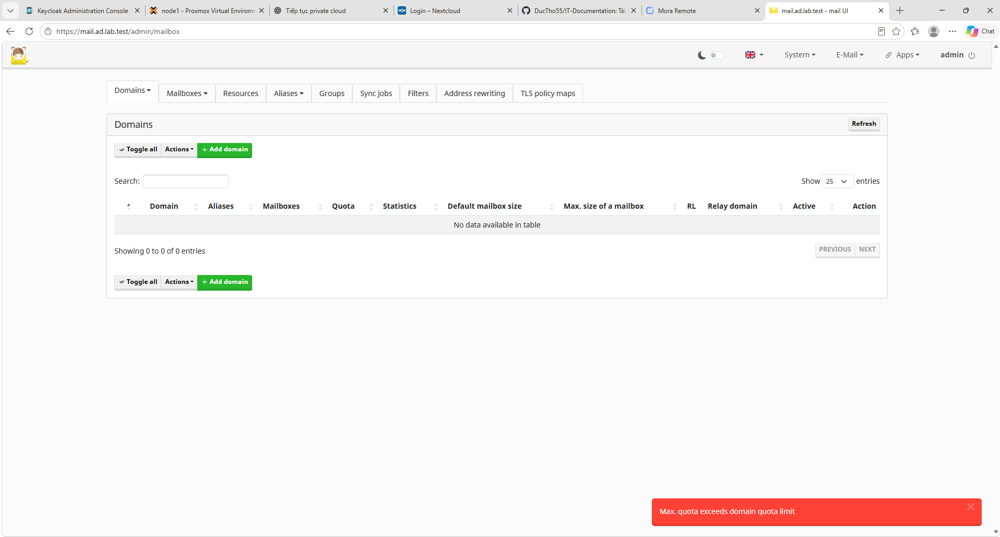
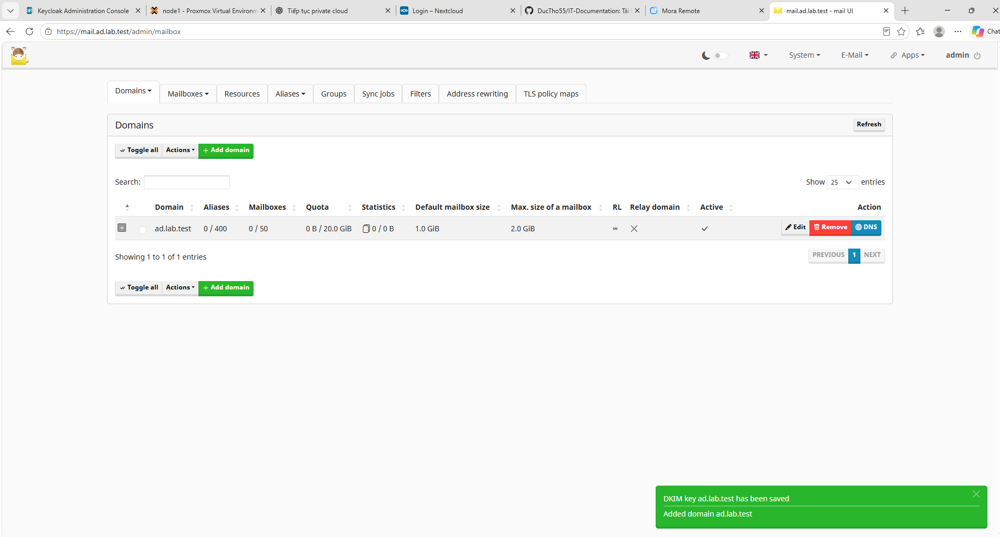

# HƯỚNG DẪN CÀI MAILCOW SAU HAPROXY (mail.ad.lab.test)

> Cài trên **cùng máy cloud-lab-01** (VM 2000, `172.16.120.243`) với Nextcloud/Keycloak.
> Web Mailcow chỉ nghe `127.0.0.1:8090/8453`, HAProxy đưa ra ngoài `https://mail.ad.lab.test`.
> Các cổng mail (25, 465, 587, 143, 993, 110, 995, 4190) do Mailcow nghe trực tiếp.

| Yêu cầu | LAB |
|---|---|
| RAM | ≥ 6 GB (VM có 7.8 GB; đã **tắt ClamAV** cho nhẹ) |
| Ổ đĩa | ≥ 20 GB trống |
| Quyền | `sudo` |
| Cổng 80/443 | HAProxy đang dùng 443 → Mailcow phải đổi cổng web |

Script dùng trong LAB nằm ở [`scripts/mailcow`](../scripts/mailcow). Các bước dưới đây là nội dung của script, có thể chạy tay từng lệnh.

---

## 1. Cài Mailcow
```bash
sudo apt-get install -y git jq
sudo git clone https://github.com/mailcow/mailcow-dockerized /opt/mailcow-dockerized
cd /opt/mailcow-dockerized
sudo MAILCOW_HOSTNAME=mail.ad.lab.test MAILCOW_TZ=Asia/Ho_Chi_Minh MAILCOW_BRANCH=master ./generate_config.sh
```

## 2. Chỉnh `mailcow.conf`
```bash
sudo cp -n mailcow.conf mailcow.conf.orig
sudo nano mailcow.conf
```
Các dòng cần có:
```ini
MAILCOW_HOSTNAME=mail.ad.lab.test
HTTP_PORT=8090
HTTP_BIND=127.0.0.1
HTTPS_PORT=8453
HTTPS_BIND=127.0.0.1
HTTP_REDIRECT=n
SKIP_LETS_ENCRYPT=y
SKIP_CLAMD=y
TZ=Asia/Ho_Chi_Minh
```
> - `HTTP_BIND=127.0.0.1` → web Mailcow **không** chiếm cổng 80/443 của HAProxy.
> - `SKIP_LETS_ENCRYPT=y` → domain `.test` không xin được Let's Encrypt; dùng CA nội bộ (mục 4).
> - Các biến `ENABLE_SSL`, `FORCE_HTTPS`, `TRUSTED_PROXIES` **không** phải biến của mailcow.conf, thêm vào không có tác dụng.

Khởi động:
```bash
sudo docker compose pull
sudo docker compose up -d
sudo docker compose ps --format '{{.Service}}\t{{.State}}'
curl -s -o /dev/null -w 'web:%{http_code}\n' http://127.0.0.1:8090/    # web:200
```

## 3. Tên miền
LAB không dùng DNS cho các tên này mà dùng **file hosts**:
```bash
# Trên VM 2000
echo '172.16.120.243 mail.ad.lab.test autodiscover.ad.lab.test autoconfig.ad.lab.test' | sudo tee -a /etc/hosts
```
Trên máy Windows của người dùng: thêm `mail.ad.lab.test` vào dòng `172.16.120.243 ...` ([03-HAProxy §5](03-HAProxy.md#5-phía-máy-người-dùng-windows)).

> Vì không có DNS/MX thật nên mail **chỉ gửi nhận nội bộ** `@ad.lab.test`, không gửi ra Internet.

## 4. Cấp chứng chỉ cho mail.ad.lab.test
Ký bằng **Cloud Lab Root CA** ([03-HAProxy §2](03-HAProxy.md#2-tạo-ca-nội-bộ-và-chứng-chỉ)):
```bash
CA=/etc/haproxy/lab-ca
W=$(mktemp -d)
cat > $W/ext.cnf <<'EOF'
basicConstraints=CA:FALSE
keyUsage=digitalSignature,keyEncipherment
extendedKeyUsage=serverAuth
subjectAltName=DNS:mail.ad.lab.test,DNS:autodiscover.ad.lab.test,DNS:autoconfig.ad.lab.test
EOF
sudo openssl req -new -newkey rsa:2048 -nodes -keyout $W/mail.key -out $W/mail.csr -subj "/CN=mail.ad.lab.test"
sudo openssl x509 -req -in $W/mail.csr -CA $CA/root-ca.crt -CAkey $CA/root-ca.key -CAcreateserial -CAserial $W/ca.srl \
  -days 825 -sha256 -extfile $W/ext.cnf -out $W/mail.crt
sudo install -m 644 $W/mail.crt /etc/haproxy/certs/mail.crt
sudo install -m 600 $W/mail.key /etc/haproxy/certs/mail.key
sudo bash -c "cat $W/mail.crt $W/mail.key > /etc/haproxy/certs/mail.pem"; sudo chmod 600 /etc/haproxy/certs/mail.pem
sudo rm -rf $W
```
Dùng cert này cho IMAP/SMTP/web của Mailcow (sao lưu cert cũ trước):
```bash
cd /opt/mailcow-dockerized
sudo cp -a data/assets/ssl data/assets/ssl.bak-$(date +%Y%m%d)
sudo bash -c 'cat /etc/haproxy/certs/mail.crt /etc/haproxy/lab-ca/root-ca.crt > data/assets/ssl/cert.pem'
sudo cp /etc/haproxy/certs/mail.key data/assets/ssl/key.pem
sudo docker compose restart postfix-mailcow dovecot-mailcow nginx-mailcow
```

## 5. Đưa Mailcow vào HAProxy
Trong `/etc/haproxy/haproxy.cfg` thêm (cấu hình đầy đủ ở [03-HAProxy §3](03-HAProxy.md#3-cấu-hình-etchaproxyhaproxycfg)):
```haproxy
    bind 172.16.120.243:443 ssl crt /etc/haproxy/certs/lab.pem crt /etc/haproxy/certs/mail.pem
    acl host_mail hdr(host) -i mail.ad.lab.test autodiscover.ad.lab.test autoconfig.ad.lab.test
    http-request deny unless host_auth or host_cloud or host_mail
    use_backend mailcow_backend if host_mail

backend mailcow_backend
    server mailcow 127.0.0.1:8090 check
```
```bash
sudo cp -a /etc/haproxy/haproxy.cfg /etc/haproxy/haproxy.cfg.bak-$(date +%Y%m%d)
sudo haproxy -c -f /etc/haproxy/haproxy.cfg && sudo systemctl reload haproxy

CA=/etc/haproxy/lab-ca/root-ca.crt
curl -s -o /dev/null -w 'mail: %{http_code}\n'  --cacert $CA https://mail.ad.lab.test/
curl -s -o /dev/null -w 'cloud: %{http_code}\n' --cacert $CA https://cloud.ad.lab.test/login
echo | openssl s_client -connect 127.0.0.1:993 -servername mail.ad.lab.test -CAfile $CA 2>/dev/null | grep 'Verify return code'
```
Kết quả LAB: `mail: 200`, `cloud: 200`, `Verify return code: 0 (ok)`.

## 6. Cho Mailcow gọi được Keycloak
Container `php-fpm-mailcow` cần **biết** `auth.ad.lab.test` và **tin** Cloud Lab Root CA. Không sửa file gốc, dùng `docker-compose.override.yml`:
```bash
cd /opt/mailcow-dockerized
sudo mkdir -p data/conf/custom-ca
sudo bash -c 'docker compose exec -T php-fpm-mailcow cat /etc/ssl/certs/ca-certificates.crt > data/conf/custom-ca/ca-certificates.crt'
sudo bash -c 'cat /etc/haproxy/lab-ca/root-ca.crt >> data/conf/custom-ca/ca-certificates.crt'

sudo tee docker-compose.override.yml > /dev/null <<'EOF'
services:
  php-fpm-mailcow:
    extra_hosts:
      - "auth.ad.lab.test:172.16.120.243"
      - "cloud.ad.lab.test:172.16.120.243"
    volumes:
      - ./data/conf/custom-ca/ca-certificates.crt:/etc/ssl/certs/ca-certificates.crt:ro
EOF
sudo docker compose config -q && sudo docker compose up -d php-fpm-mailcow
```
Kiểm tra từ trong container:
```bash
sudo docker compose exec -T php-fpm-mailcow php -r '$c=curl_init("https://auth.ad.lab.test/realms/cloud-lab/.well-known/openid-configuration");curl_setopt($c,CURLOPT_RETURNTRANSFER,1);curl_exec($c);echo curl_getinfo($c,CURLINFO_HTTP_CODE)," ",curl_error($c)?:"tls ok",PHP_EOL;'
# 200 tls ok
```

## 7. Cấu hình trong giao diện Mailcow
### 7.1 Đăng nhập admin
`https://mail.ad.lab.test/admin` – tài khoản mặc định `admin` / `moohoo`. **Đổi mật khẩu ngay**: System → Configuration → Access → Administrators → Edit.



### 7.2 Tạo domain
**E-Mail → Configuration → Domains → Add domain**:

| Ô | Giá trị |
|---|---|
| Domain | `ad.lab.test` |
| Max. possible mailboxes | `50` |
| Default mailbox quota | `1024` |
| Max. quota per mailbox (MiB) | `2048` |
| Total domain quota (MiB) | `20480` |

Quy tắc: **Default ≤ Max per mailbox ≤ Total**, nếu không sẽ báo *Max. quota exceeds domain quota limit*.





Bước tiếp theo – kết nối Keycloak và Nextcloud: [07-Lien-ket-Mail-Keycloak-Nextcloud](07-Lien-ket-Mail-Keycloak-Nextcloud.md).

---

## Lỗi thường gặp

| Hiện tượng | Cách xử lý |
|---|---|
| Mailcow chiếm 80/443, HAProxy không start | `HTTP_BIND=127.0.0.1`, `HTTP_PORT=8090`, `HTTPS_PORT=8453` |
| Trình duyệt không mở được `mail.ad.lab.test` | Thiếu `mail.ad.lab.test` trong file hosts máy người dùng |
| Nextcloud Mail lỗi SSL khi nối IMAP | Chưa thay `data/assets/ssl/cert.pem` (mục 4) |
| Đăng nhập admin sai | Mặc định `admin`/`moohoo`; log: `docker compose logs php-fpm-mailcow \| grep "Invalid password"` |
| RAM đầy, container treo | `SKIP_CLAMD=y`, kiểm tra `free -h` |
