# HƯỚNG DẪN LIÊN KẾT MAILCOW – KEYCLOAK – NEXTCLOUD

> Mục tiêu:
> 1. User AD đăng nhập **Mailcow / SOGo webmail** bằng **Keycloak (SSO)**, hộp thư được **tạo tự động**.
> 2. Mailcow **đồng bộ danh sách user** từ Keycloak (Identity Sync).
> 3. **Nextcloud Mail** đọc/gửi thư của user qua IMAP/SMTP.

Yêu cầu trước: đã làm xong [05-Keycloak](05-Keycloak.md) và [06-MailCow](06-MailCow.md), user AD **có E-mail** `@ad.lab.test`.

---

## 1. Cấu hình trên Keycloak (realm `cloud-lab`)

### 1.1 Tạo client `mailcow`
**Clients → Create client**:
- **General settings**: Client ID `mailcow`, Name `Mailcow`
- **Capability config**: **Client authentication = On**, tích **Standard flow** và **Service account roles**
- **Login settings**:

| Mục | Giá trị |
|---|---|
| Root URL / Home URL | `https://mail.ad.lab.test` |
| Valid redirect URIs | `https://mail.ad.lab.test/*` |
| Valid post logout redirect URIs | `https://mail.ad.lab.test/*` |
| Web origins | `https://mail.ad.lab.test` |

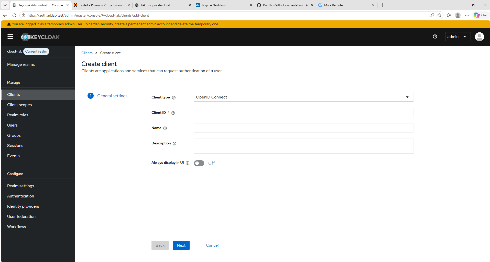
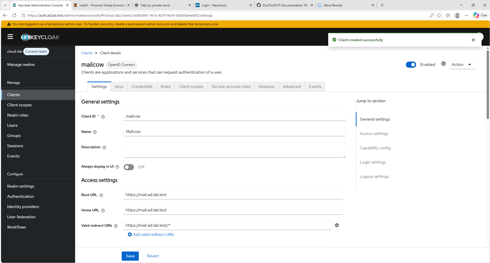

### 1.2 Cho service account quyền đọc user
Client `mailcow` → tab **Service account roles** → **Assign role** → **Client roles** → tìm `view-users` (client `realm-management`) → **Assign**.

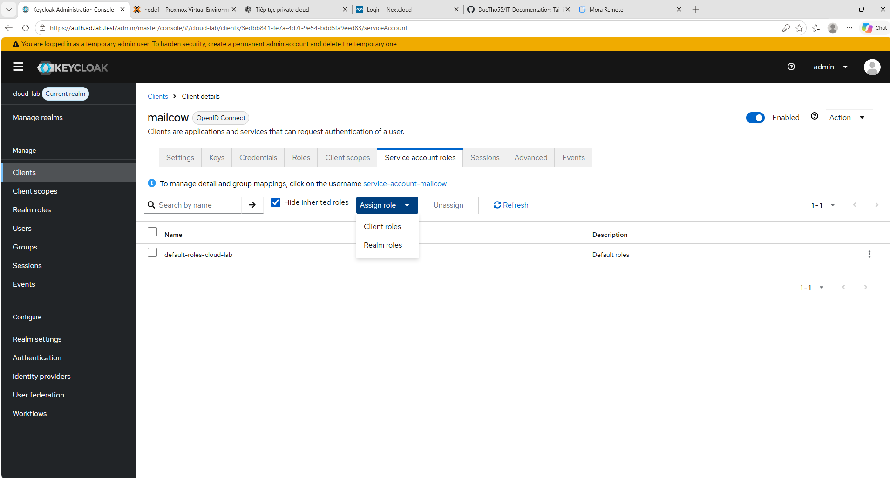

### 1.3 Gán mẫu hộp thư cho user AD
Mailcow chỉ tạo hộp thư cho user có thuộc tính `mailcow_template`. User AD ở chế độ READ_ONLY nên gán cố định qua mapper LDAP:

**User federation → ldap → tab Mappers → Add mapper**:

| Ô | Giá trị |
|---|---|
| Name | `mailcow_template` |
| Mapper type | `hardcoded-attribute-mapper` |
| User Model Attribute Name | `mailcow_template` |
| Attribute Value | `default` |

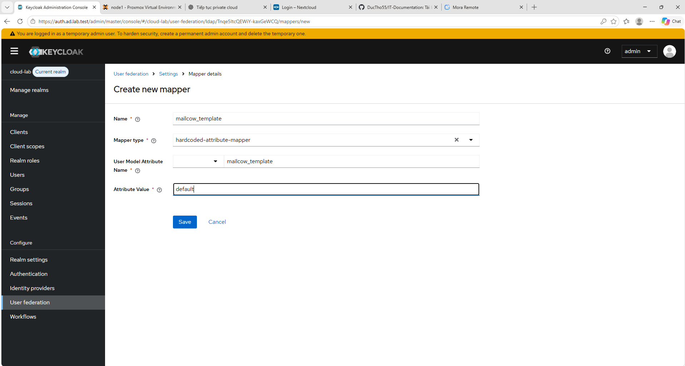

> Nếu Mailcow không thấy thuộc tính: **Realm settings → General → Unmanaged attributes = Enabled → Save**. Ở mục 2 cũng đặt **Default Template = Default** làm dự phòng.

### 1.4 ⚠️ Bắt buộc với Keycloak ≥ 26.8: audience + scope Admin API
Từ Keycloak 26.8, token gọi Admin API (`/admin/realms/...`) phải có:
- `aud` chứa `https://auth.ad.lab.test/admin/realms/cloud-lab`
- `scope` chứa `kc-admin-api`

Thiếu hai điều này, Mailcow báo **`Identity Sync: Run failed: Keycloak returned HTTP 401 for /users`** dù secret và quyền `view-users` đều đúng. (Hướng dẫn Mailcow chưa nhắc tới.)

**a) Mapper Admin API Audience** – client `mailcow` → **Client scopes** → `mailcow-dedicated` → **Configure a new mapper** → **Admin API Audience**:
- Name `admin-api-audience`, **Add to access token = On** → **Save**

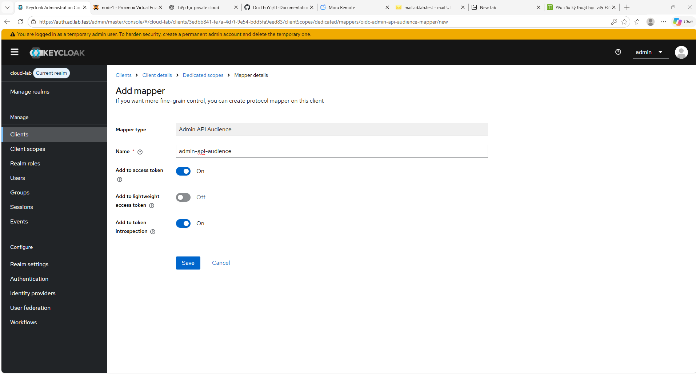

**b) Scope `kc-admin-api`** – client `mailcow` → **Client scopes** → **Add client scope** → tích `kc-admin-api` → **Add → Default** (không chọn Optional).
Nếu realm chưa có scope này: **Client scopes → Create client scope** → Name `kc-admin-api`, Type `None`, Protocol `OpenID Connect`, *Include in token scope* On → Save, rồi gán như trên.

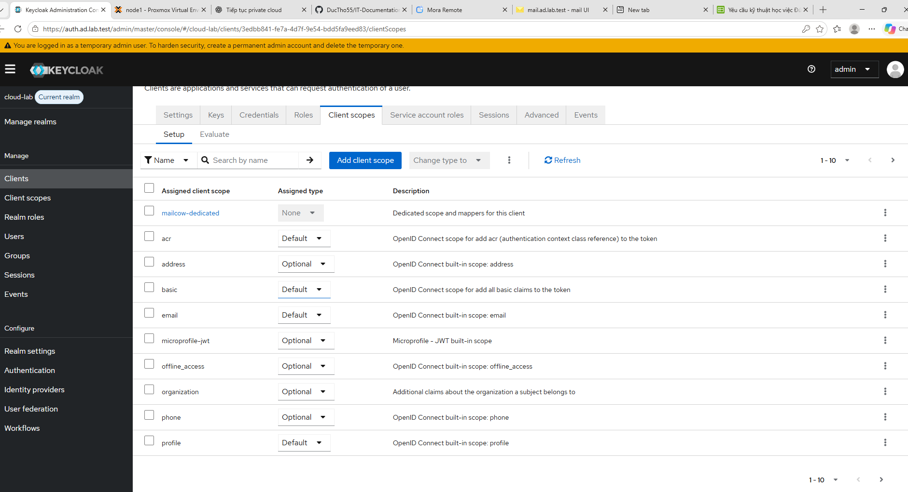

### 1.5 Lấy Client Secret
Client `mailcow` → **Credentials** → copy **Client Secret** (không lưu vào tài liệu).

## 2. Cấu hình trên Mailcow
**System → Configuration → Access → Identity Provider** → chọn **Keycloak**:

| Ô | Giá trị |
|---|---|
| Server Url | `https://auth.ad.lab.test` |
| Realm | `cloud-lab` |
| Version | `26.0.0` |
| Client ID | `mailcow` |
| Client Secret | dán từ Keycloak |
| Ignore SSL Errors | **Off** (container đã tin CA – [06-MailCow §6](06-MailCow.md#6-cho-mailcow-gọi-được-keycloak)) |
| Redirect Url | `https://mail.ad.lab.test` |
| Mailpassword Flow | Off |
| Auto-create users on login | **On** |
| Default Template | `Default` |
| Attribute Mapping | `default` → `Default` |
| Import Users | On, interval `15` phút |

Bấm **Test Connection** (xanh) → **Save changes**.

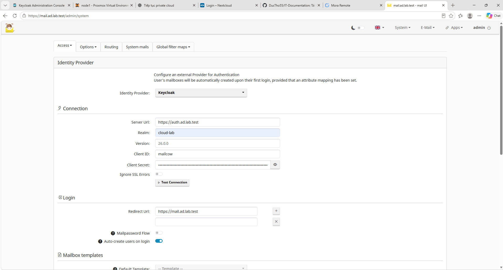
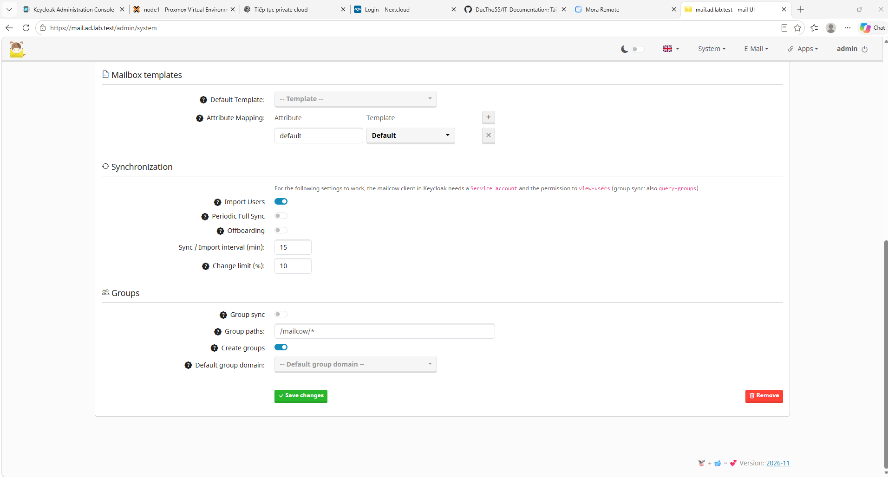
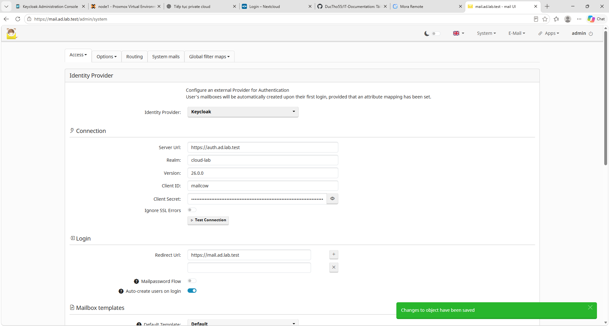

## 3. Kiểm tra đăng nhập Mailcow bằng Keycloak
1. Cửa sổ **InPrivate** → `https://mail.ad.lab.test`.
2. **Không** gõ vào ô Email/Password của Mailcow. Bấm nút **Single Sign-On** (dưới dòng *or login with*).
3. Trang **CLOUD-LAB** (auth.ad.lab.test) → nhập user AD `ductho` + mật khẩu AD → Sign In.
4. Vào thẳng **SOGo webmail**; hộp thư `ductho@ad.lab.test` được tạo tự động.

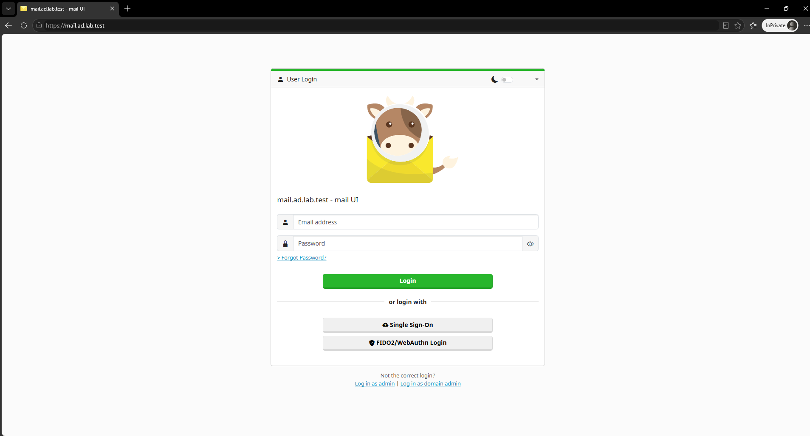
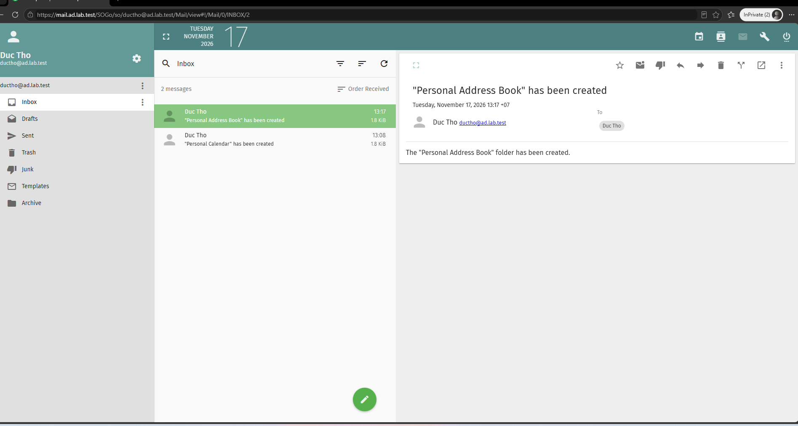

Kiểm tra trên server:
```bash
cd /opt/mailcow-dockerized && source mailcow.conf
sudo docker compose exec -T mysql-mailcow mysql -u"$DBUSER" -p"$DBPASS" "$DBNAME" -e "SELECT username,authsource,active FROM mailbox;"
# ductho@ad.lab.test   keycloak   1
```

Kiểm tra Admin API (đồng bộ user) – token phải có `kc-admin-api` và `/users` trả `200`:
```bash
TOK=$(curl -s --cacert /etc/haproxy/lab-ca/root-ca.crt https://auth.ad.lab.test/realms/cloud-lab/protocol/openid-connect/token \
  -d grant_type=client_credentials -d client_id=mailcow --data-urlencode "client_secret=<SECRET>" \
  | python3 -c 'import sys,json;print(json.load(sys.stdin)["access_token"])')
curl -s -o /dev/null -w '%{http_code}\n' --cacert /etc/haproxy/lab-ca/root-ca.crt \
  -H "Authorization: Bearer $TOK" "https://auth.ad.lab.test/admin/realms/cloud-lab/users?max=1"   # 200
```

## 4. Tạo App password cho Nextcloud
User đăng nhập bằng Keycloak **không có mật khẩu IMAP riêng** → dùng App password.

1. Đang đăng nhập SSO, mở `https://mail.ad.lab.test/user` → tab **App passwords** → **Create app password**.
2. App name `Nextcloud`, bấm **generate**, **copy lưu lại ngay** (không xem lại được), Protocols: **IMAP, SMTP** → **Add**.

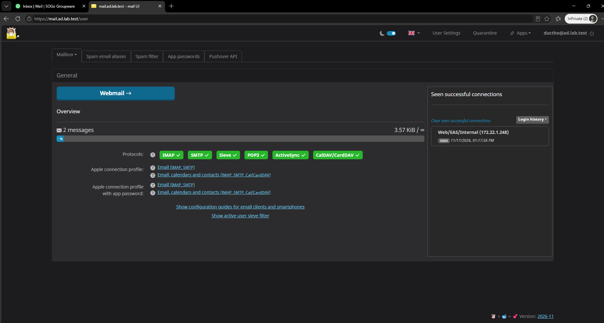
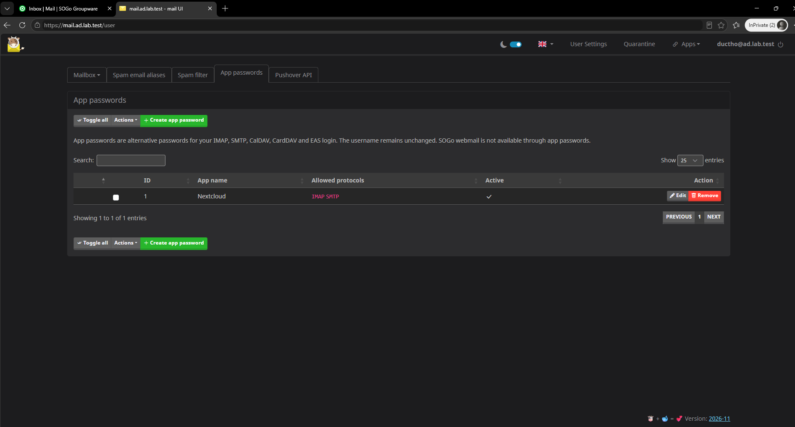

> ⚠️ Không chụp màn hình lúc mật khẩu đang hiện. Lộ rồi thì **Remove** và tạo lại.

## 5. Thêm hộp thư vào Nextcloud Mail
App Mail đã cài ở [04-Nextcloud §7](04-Nextcloud.md#7-cài-app-cần-dùng). Container Nextcloud cần phân giải được `mail.ad.lab.test` và tin CA (image `ca-v1`):
```bash
sudo docker exec cloud-lab-nextcloud-app-1 getent hosts mail.ad.lab.test
sudo docker exec cloud-lab-nextcloud-app-1 bash -c 'echo | openssl s_client -connect mail.ad.lab.test:993 -servername mail.ad.lab.test 2>/dev/null | grep "Verify return code"'
# Verify return code: 0 (ok)
```

Đăng nhập Nextcloud bằng Keycloak (`ductho`) → mở **Mail** → tab **Manual**:

| Ô | Giá trị |
|---|---|
| Name | `Duc Tho` |
| Mail address | `ductho@ad.lab.test` |
| IMAP Host / Security / Port | `mail.ad.lab.test` / **SSL/TLS** / `993` |
| IMAP User / Password | `ductho@ad.lab.test` / **App password** |
| SMTP Host / Security / Port | `mail.ad.lab.test` / **SSL/TLS** / `465` |
| SMTP User / Password | `ductho@ad.lab.test` / **App password** |

Bấm **Connect**.

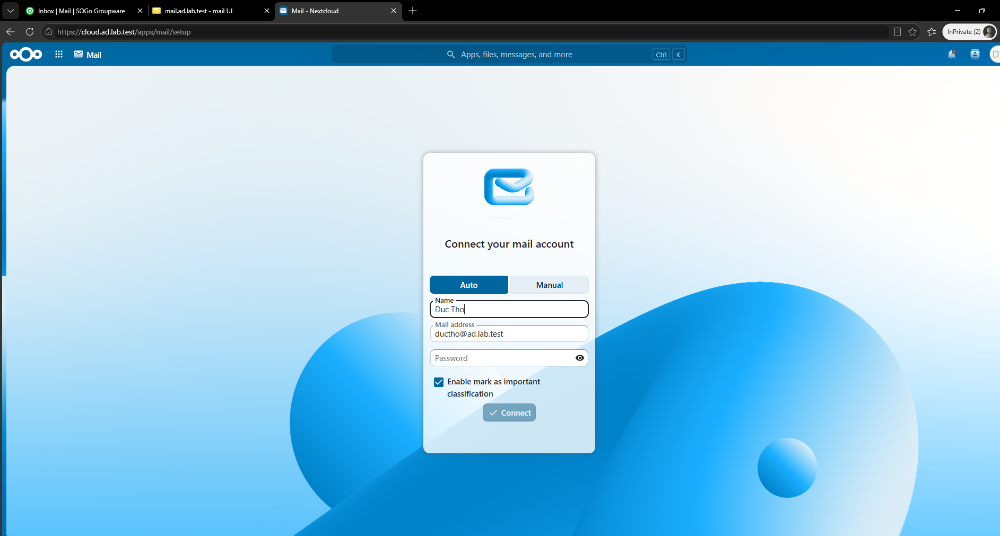
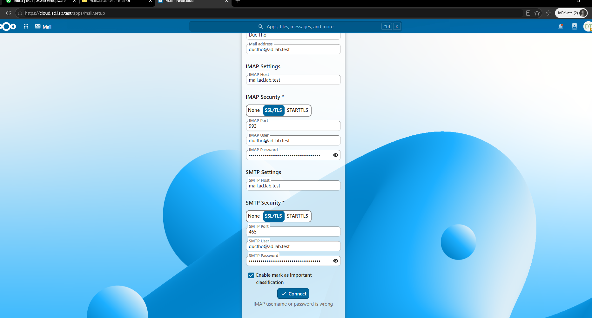
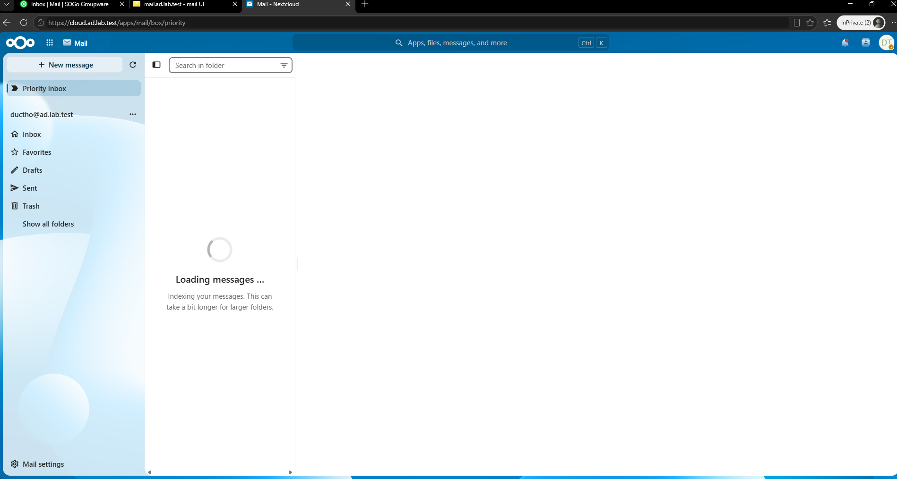

### Kiểm tra gửi/nhận thư
Bấm **New message**, gửi thư cho chính `ductho@ad.lab.test`. Sau vài giây thư xuất hiện trong **Inbox** của Nextcloud Mail (và cả SOGo) → luồng **Nextcloud → SMTP 465 → Mailcow → IMAP 993 → Nextcloud** hoạt động.

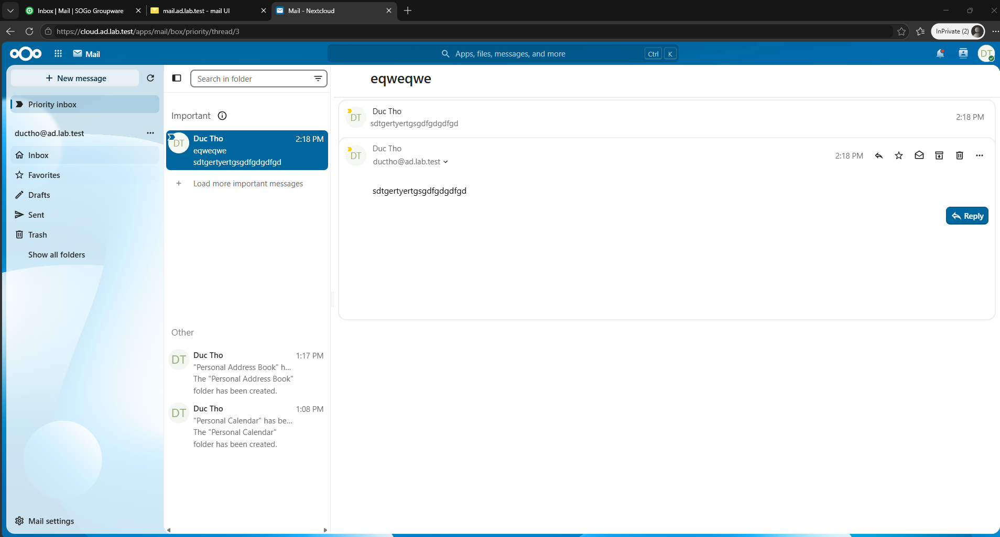

---

## Lỗi thường gặp

| Hiện tượng | Nguyên nhân | Cách xử lý |
|---|---|---|
| Log Mailcow `Invalid password for ductho` | Gõ user AD vào ô đăng nhập **của Mailcow** | Bấm **Single Sign-On** |
| Keycloak *Invalid username or password*, log `user_not_found` + `Connect timed out` | Mất route VM 2000 → AD | [05-Keycloak §2](05-Keycloak.md#2-route-tới-samba-ad) |
| Không tạo hộp thư sau khi đăng nhập | User AD thiếu E-mail / thiếu `mailcow_template` | Điền E-mail trong ADUC; mapper mục 1.3; Default Template |
| `Identity Sync: Keycloak returned HTTP 401 for /users` | Keycloak 26.8: thiếu audience / scope `kc-admin-api` | Mục 1.4 |
| Debug log Keycloak: `Expected audience not available in the token` | Thiếu mapper Admin API Audience | Mục 1.4a |
| Nextcloud Mail: *IMAP username or password is wrong* | Dùng mật khẩu AD hoặc copy App password thiếu ký tự | Dùng App password, copy-paste (Ctrl+A, Ctrl+C) |
| Nextcloud Mail lỗi SSL | Cert Mailcow tự ký / Nextcloud không tin CA | [06-MailCow §4](06-MailCow.md#4-cấp-chứng-chỉ-cho-mailadlabtest), image `ca-v1` |
