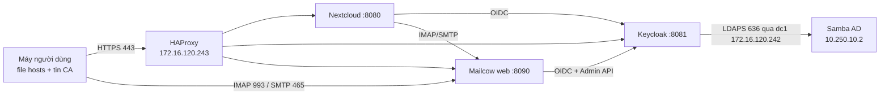

# Hướng dẫn triển khai từng bước

Làm theo thứ tự:

| # | Hướng dẫn | Máy | Nội dung |
|---|---|---|---|
| 1 | [Samba AD](01-Samba-AD.md) | VM 2001 `dc1` | Namespace `samba-lab`, provision `ad.lab.test`, DNS forwarder, ufw, OU/user |
| 2 | [Windows quản trị AD](02-Windows-AD-MGMT.md) | VM 2002 | Tạo VM, RSAT, route + DNS tới AD, ADUC tạo user |
| 3 | [HAProxy + CA nội bộ](03-HAProxy.md) | VM 2000 | Cloud Lab Root CA, cert, HAProxy 443, file hosts |
| 4 | [Nextcloud](04-Nextcloud.md) | VM 2000 | Docker Compose, image tin CA, chạy sau proxy |
| 5 | [Keycloak](05-Keycloak.md) | VM 2000 | Compose, route tới AD, LDAP federation, SSO Nextcloud |
| 6 | [Mailcow](06-MailCow.md) | VM 2000 | Cài sau HAProxy, cert, override cho Keycloak, domain |
| 7 | [Liên kết Mail – Keycloak – Nextcloud](07-Lien-ket-Mail-Keycloak-Nextcloud.md) | — | Client `mailcow`, Keycloak 26.8 Admin API, SSO webmail, Nextcloud Mail |

## Sơ đồ

## Khác biệt so với hướng dẫn gốc (Let's Encrypt, DNS công khai)
- Domain `.test` → dùng **Cloud Lab Root CA** thay cho certbot; tên miền khai báo bằng **file hosts**, mail chỉ nội bộ.
- Tất cả dịch vụ web trên **một VM**, chỉ nghe `127.0.0.1`, HAProxy là cổng vào duy nhất.
- Mailcow dùng **App password** cho Nextcloud thay cho *Mailpassword Flow* (không phải lưu hash mật khẩu trong Keycloak).
- **Keycloak 26.8** cần thêm mapper *Admin API Audience* và scope `kc-admin-api` cho client `mailcow`.

Script dùng trong LAB: [`scripts/mailcow`](../scripts/mailcow/README.md).
