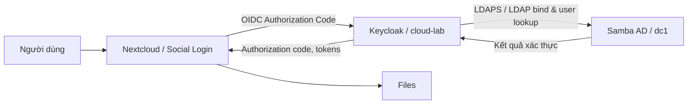

# Private Cloud LAB — Tài liệu triển khai bằng ảnh thực tế

> Nhật ký kỹ thuật theo hai nhánh **01. Samba Active Directory LAB** và **02. Private Cloud LAB (Keycloak + Nextcloud)**. Biên soạn từ các ảnh chụp màn hình trong quá trình triển khai ngày 10–16/11/2026. Các lệnh là nhật ký/thao tác đã kiểm chứng trong LAB, **không phải script chạy tự động trên hệ thống bất kỳ**.

## Bắt đầu từ đâu?

| Dự án | Tài liệu chính | Phạm vi |
|---|---|---|
| **Hướng dẫn từng bước** | [Mở bộ hướng dẫn 01 → 07](Huong-dan-cau-hinh-Private-Cloud-SSO/README.md) | Samba AD, Windows ADUC, HAProxy, Nextcloud, Keycloak, Mailcow, liên kết SSO + Mail |
| 01 — Samba AD | [Mở tài liệu Samba AD](01-samba-ad/README.md) | VM Samba DC, DNS/Kerberos, OU/người dùng, Windows ADUC, LDAPS |
| 02 — Private Cloud | [Mở tài liệu Nextcloud + Keycloak](02-private-cloud/README.md) | Docker, HAProxy, TLS, OIDC SSO, Social Login, chứng chỉ CA |
| Hai dự án | [Sơ đồ kiến trúc](ARCHITECTURE.md) | Đường đi đăng nhập, máy chủ, domain |
| Bộ ảnh | [Danh mục ảnh](gallery/README.md) | Ảnh gốc theo mốc thời gian, đã lọc ảnh không thuộc hai dự án |
| Kiểm thử | [Bảng kiểm tra](docs/VALIDATION.md) | DNS, LDAP, OIDC, TLS, Nextcloud, Docker |
| Lỗi thực tế | [Troubleshooting](docs/TROUBLESHOOTING.md) | LDAP 49/52e, SSL curl (60), Too many requests, thiếu quyền Docker |

## Tóm tắt môi trường đã ghi nhận

| Mục | Thông tin trong LAB |
|---|---|
| Hypervisor | Proxmox VE, VM 2000/2001 (và VM Windows quản trị) |
| Nextcloud / Keycloak | `cloud-lab-01` / `172.16.120.243` |
| Domain AD | `ad.lab.test` |
| Samba DC | `dc1`, DNS AD trong namespace `samba-lab` tại `10.250.10.2` |
| Keycloak | `https://auth.ad.lab.test`, Realm `cloud-lab`, Docker Keycloak 26.8.2 |
| Nextcloud | `https://cloud.ad.lab.test`, phiên bản kiểm tra `35.0.2.2` |
| Reverse proxy | HAProxy trên `172.16.120.243:443` |
| OIDC Client | `nextcloud`, Redirect URI của Social Login |
| CA | `Cloud Lab Root CA` — chứng chỉ tự quản lý nội bộ |

> **Bảo mật:** Ảnh chứa tên miền nội bộ, địa chỉ mạng, màn hình quản trị và có thể chứa thông tin vận hành. **Chỉ đưa kho này lên repository GitHub PRIVATE sau khi rà soát**. Không commit mật khẩu, khóa CA, khóa TLS, Docker `.env` hay Client Secret. Xem [Security Notes](docs/SECURITY.md).

## Dòng chảy SSO

## Đưa tài liệu lên GitHub

Xem [hướng dẫn đưa lên GitHub/GitLab](PUBLISH_TO_GITHUB.md). Kiểm tra thông tin nhạy cảm trước khi commit.

## Lưu ý nguồn ảnh

Bộ ảnh gồm những screenshot *thực sự lấy lại được* từ cuộc trò chuyện hiện tại và các ảnh lịch sử truy xuất được, không gồm ảnh cá nhân/ảnh học tập không liên quan. Một số ảnh cũ không thể xuất file do hạn chế quyền truy xuất của thư viện; tài liệu không tự dựng lại chúng. Nhật ký chi tiết có trong [IMAGE_SOURCES.md](docs/IMAGE_SOURCES.md).
