# Ảnh 2026-11-12 · Phần 2

[← Danh mục ngày](../2026-11-12.md) · [← Toàn bộ gallery](../README.md)

### 03:37:32 UTC

Windows Server quản trị AD, Proxmox VM, công cụ RSAT và DNS

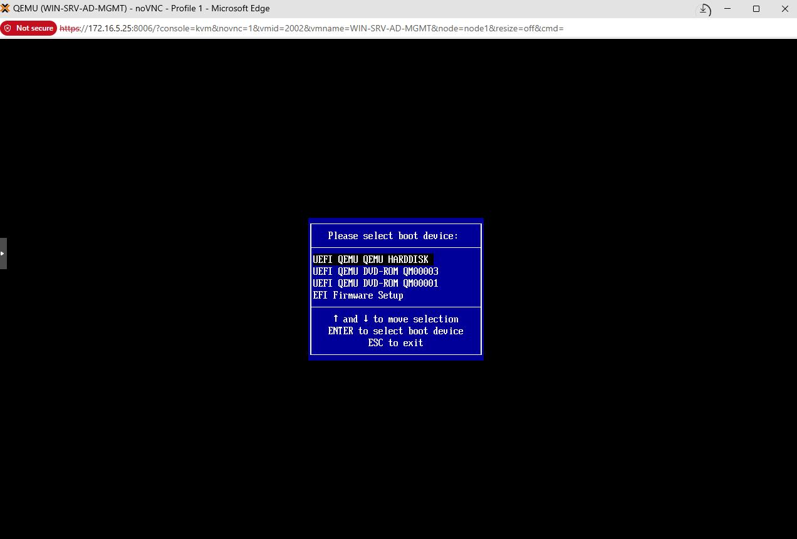

### 03:40:39 UTC

Windows Server quản trị AD, Proxmox VM, công cụ RSAT và DNS

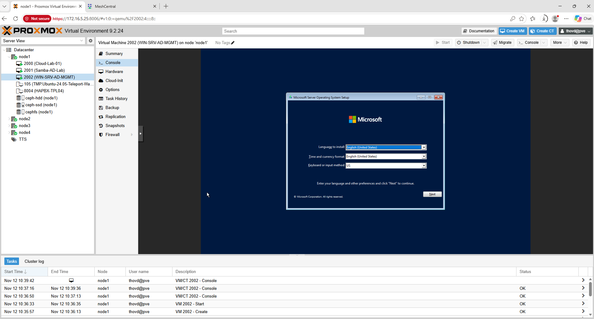

### 03:41:41 UTC

Windows Server quản trị AD, Proxmox VM, công cụ RSAT và DNS

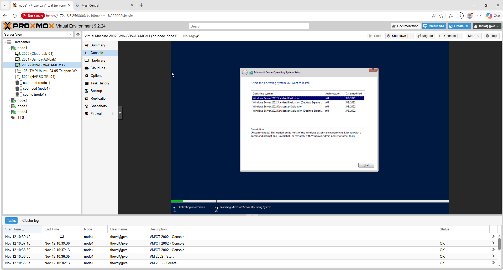

### 03:44:16 UTC

Windows Server quản trị AD, Proxmox VM, công cụ RSAT và DNS

### 03:45:33 UTC

Windows Server quản trị AD, Proxmox VM, công cụ RSAT và DNS

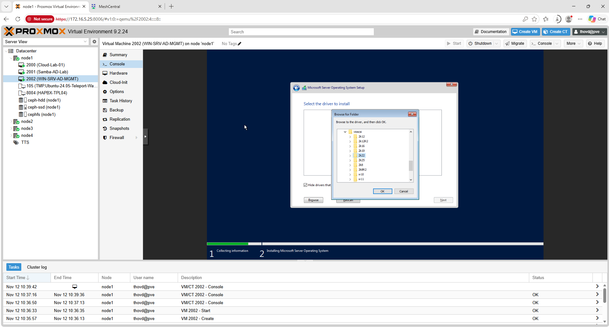

### 03:46:36 UTC

Windows Server quản trị AD, Proxmox VM, công cụ RSAT và DNS

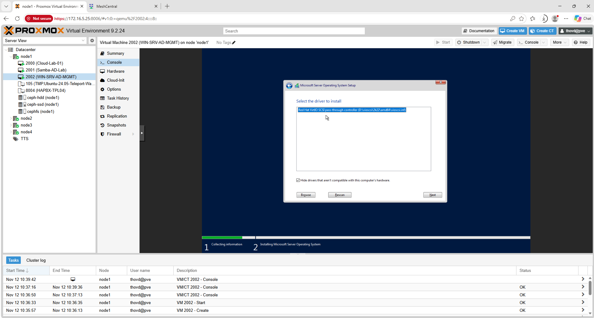

### 03:53:37 UTC

Windows Server quản trị AD, Proxmox VM, công cụ RSAT và DNS

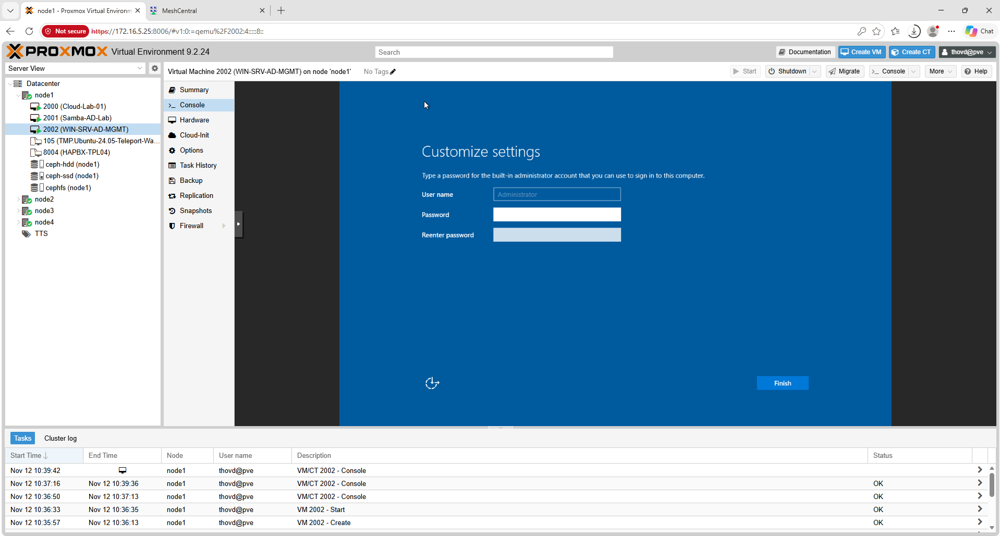

### 03:55:49 UTC

Windows Server quản trị AD, Proxmox VM, công cụ RSAT và DNS

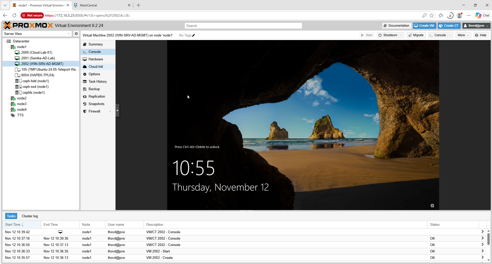

### 04:05:13 UTC

Windows Server quản trị AD, Proxmox VM, công cụ RSAT và DNS

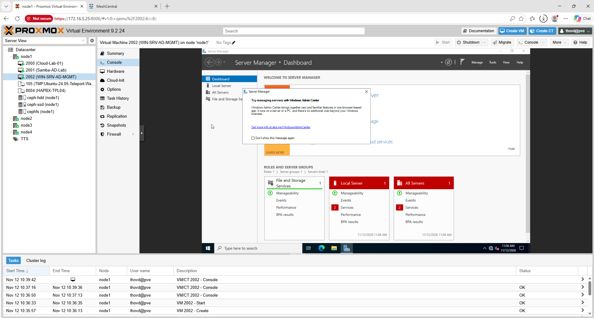

### 04:08:22 UTC

Windows Server quản trị AD, Proxmox VM, công cụ RSAT và DNS

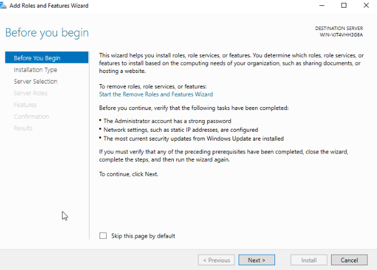

### 04:13:06 UTC

Windows Server quản trị AD, Proxmox VM, công cụ RSAT và DNS

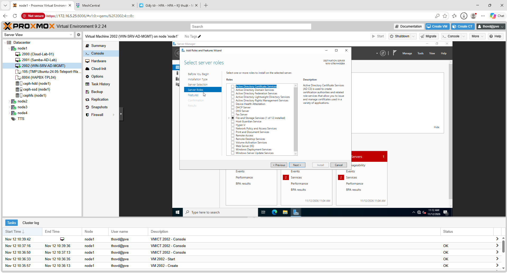

### 04:15:30 UTC

Windows Server quản trị AD, Proxmox VM, công cụ RSAT và DNS

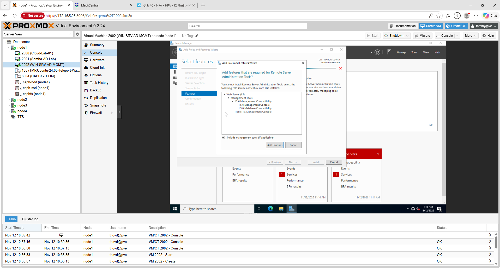

### 04:17:09 UTC

Windows Server quản trị AD, Proxmox VM, công cụ RSAT và DNS

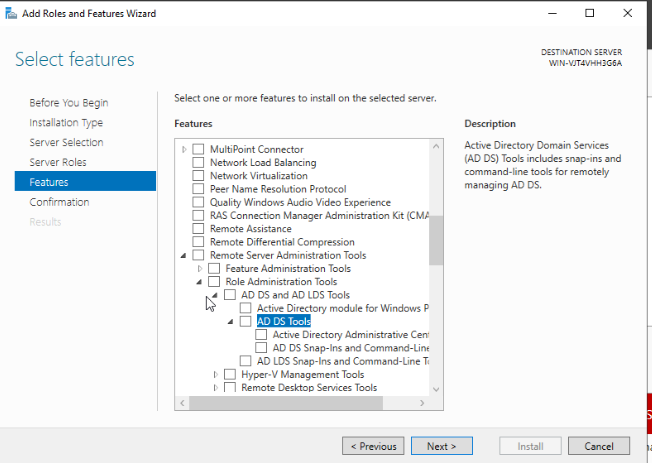

### 04:18:10 UTC

Windows Server quản trị AD, Proxmox VM, công cụ RSAT và DNS

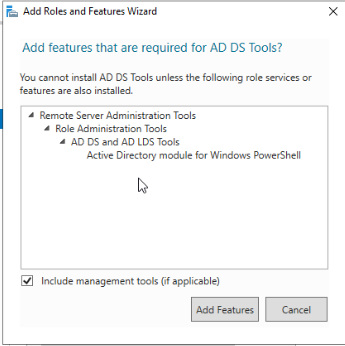

### 04:20:08 UTC

Windows Server quản trị AD, Proxmox VM, công cụ RSAT và DNS

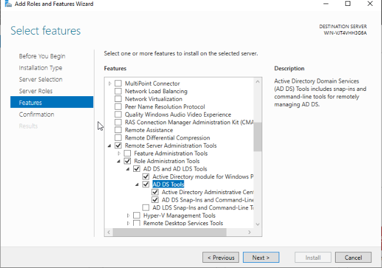

### 04:23:35 UTC

Windows Server quản trị AD, Proxmox VM, công cụ RSAT và DNS

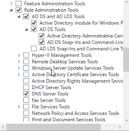

### 04:23:56 UTC

Windows Server quản trị AD, Proxmox VM, công cụ RSAT và DNS

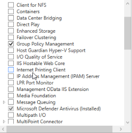

### 04:33:32 UTC

Windows Server quản trị AD, Proxmox VM, công cụ RSAT và DNS

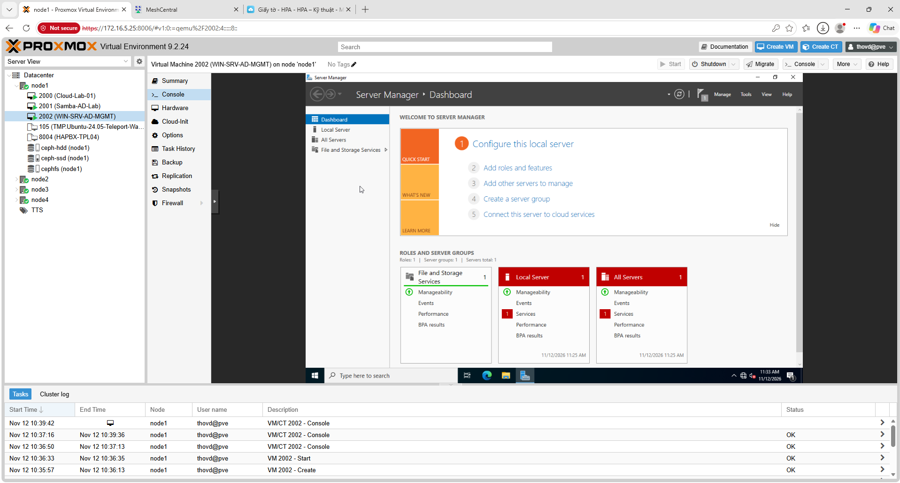

### 04:37:14 UTC

Windows Server quản trị AD, Proxmox VM, công cụ RSAT và DNS

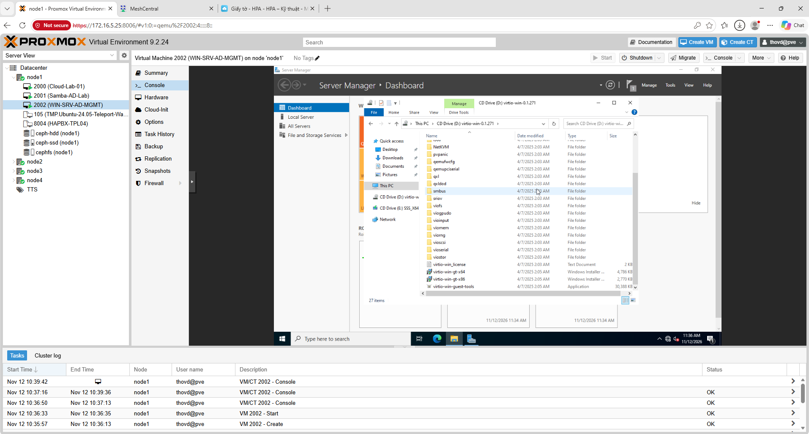

### 04:38:23 UTC

Windows Server quản trị AD, Proxmox VM, công cụ RSAT và DNS

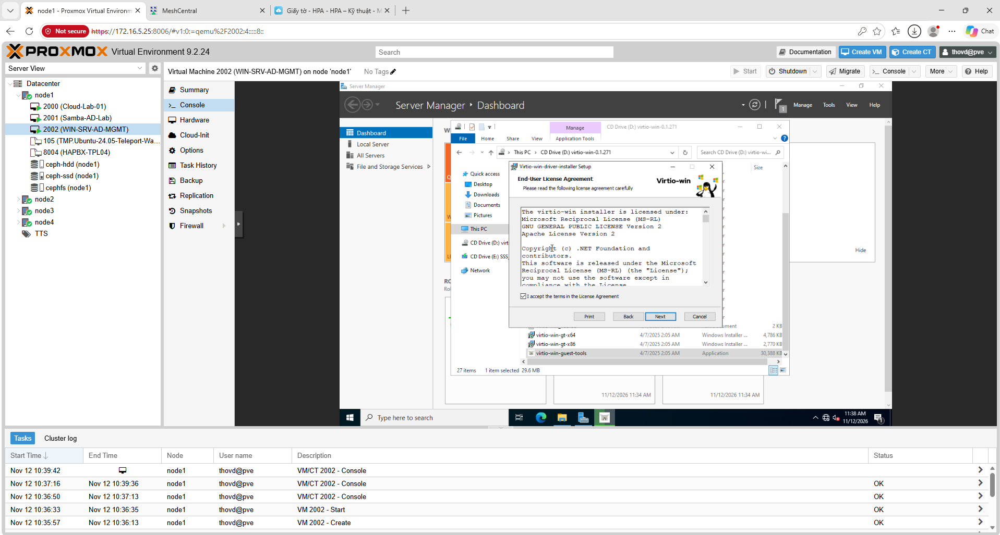

### 06:05:26 UTC

Windows Server quản trị AD, Proxmox VM, công cụ RSAT và DNS

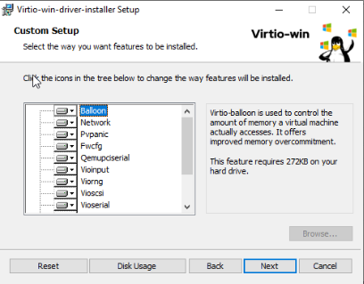

### 06:08:32 UTC

Windows Server quản trị AD, Proxmox VM, công cụ RSAT và DNS

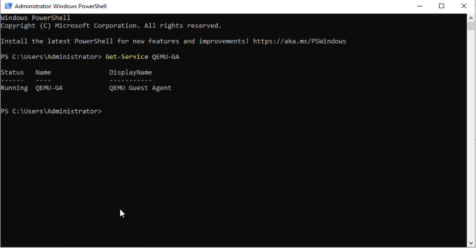

### 06:13:17 UTC

Windows Server quản trị AD, Proxmox VM, công cụ RSAT và DNS

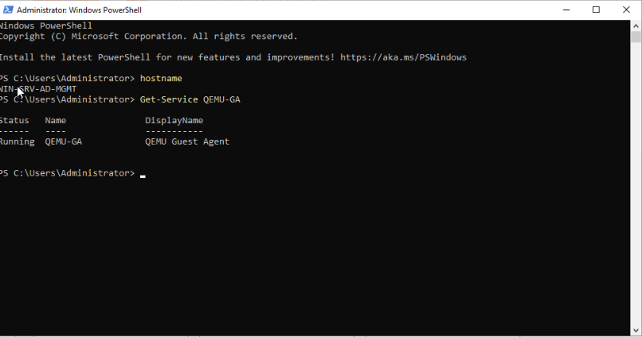

### 06:14:59 UTC

Windows Server quản trị AD, Proxmox VM, công cụ RSAT và DNS

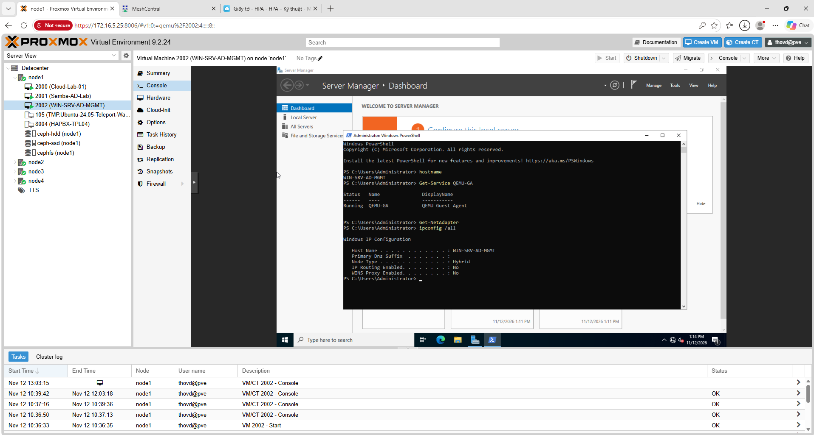

